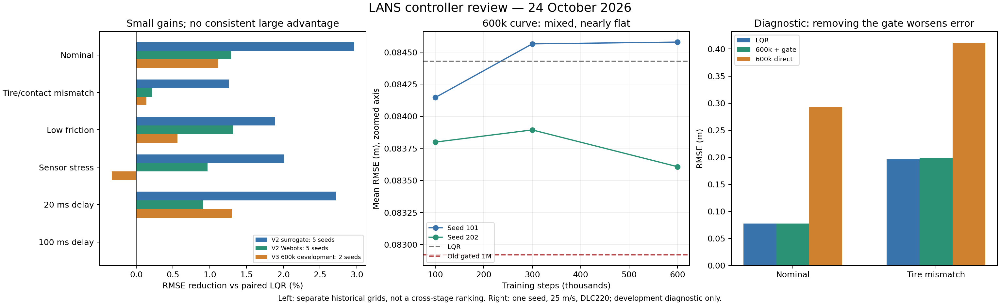

# LANS controller review: why LQR remains strong

Reviewed 24 October 2026 (Asia/Shanghai), source commit **b221686b2c010eb02a0cef54125bca8cbaa1e4ba**. Requested scope: review work completed so far, identify code/experimental issues behind weak AI/hybrid gains, and publish the review. This commit adds review material and reproducible diagnostics; it does not fix controllers, retrain policies, or rewrite historical evidence.

**Conclusion:** there are serious correctness defects in the original root-level pipeline, but those defects do not explain the isolated Webots research results because that pipeline uses different code. In the newer pipeline, corrected LQR is a strong baseline; PPO is trained for a different execution rule and distribution than gated deployment. The performance gate mostly protects LQR from harmful corrections, permitting small improvements. Current evidence supports a modest LQR-assisted correction, not a stronger PPO-dominant controller. Merely increasing AI weight or extending the same training is not supported.



## 1. What the results actually establish

Do not merge different grids, training roles, or simulator versions into one leaderboard. Positive improvement percentages below mean lower error than the paired LQR in that specific experiment.

### Original isolated research campaign

Recomputed from [810 episode rows](../../../integrations/webots/results/research-evaluation/episodes.csv). Each row below aggregates 45 episodes at the stated delay, five trained seeds, three speeds, three paths. Values are failure-penalized RMSE, metres.

| Added service delay | LQR | Standalone PPO | Residual | Old fusion | PPO survival |
|---|---:|---:|---:|---:|---:|
| 0 ms | 0.064036 | 0.093476 | 0.089479 | 0.088531 | 45/45 |
| 20 ms | 0.064036 | 0.230544 | 0.071185 | 0.124539 | 42/45 |
| 100 ms | 0.064036 | 2.271664 | 0.063894 | 0.064036 | 0/45 |

The aggregate standalone-PPO score is heavily affected by stale actions at 100 ms, but PPO also loses to LQR at zero added delay. Survival alone therefore cannot establish good tracking. These are the isolated research models, not the defective legacy root environment.

### Performance-gated residual: modest improvement is real in the recorded grids

Recomputed from [900 surrogate episodes](../../../integrations/webots/results/revision2-test/episodes.csv) and [270 native Webots episodes](../../../integrations/webots/results/revision2-native-test/episodes.csv). All survived. Native contact softening is not the same physical perturbation as surrogate tire-stiffness reduction.

| Region | V2 surrogate RMSE reduction | V2 native RMSE reduction | V3 600k development RMSE reduction |
|---|---:|---:|---:|
| Nominal | 2.96% | 1.29% | 1.11% |
| Tire mismatch / native contact softening | 1.26% | 0.21% | 0.14% |
| Low friction | 1.89% | 1.31% | 0.56% |
| Sensor stress | 2.01% | 0.97% | **−0.33%** |
| 20 ms | 2.72% | 0.91% | 1.30% |
| 100 ms | 0.00% | 0.00% | 0.00% |

V2 uses five policy seeds; V3 uses two repeatedly consulted development seeds. This table does not constitute a matched-budget V2-versus-V3 comparison. None of the V2 regions meets the frozen 5% clear-advantage threshold. In V2 native tests, full-command gated fusion slightly worsens contact-softening and sensor-stress means; it is not consistently better than gated residual.

The V2 residual gate is active on only **6.09–12.42%** of surrogate ticks in the five active regions; its mean blend weight is **0.0133–0.0354**. Native activation is **4.21–8.35%**, with mean weight **0.0073–0.0173**. A mean weight is not a percentage of tracking benefit or steering energy, but it shows how far execution is from PPO-dominant operation. At 100 ms the gate intentionally rejects all packets and reproduces LQR.

### The 600k continuation did not establish a useful learning trend

| Development checkpoint / reference | Mean RMSE (m) | Interpretation |
|---|---:|---|
| New baseline, 100k | 0.083973 | Two seeds, 72 cases |
| New baseline, 300k | 0.084229 | Worse than 100k |
| New baseline, 600k | 0.084093 | Only 0.162% better than 300k; one seed regresses |
| Paired LQR | 0.084428 | 600k is only 0.397% better overall |
| Old policy, rescaled, gated | 0.084201 | 600k is only 0.128% better |
| Old policy, original scaling, gated | 0.082919 | 600k is about 1.42% worse |

The old policies have 1M steps and different training seeds. These anchors do not isolate the effect of retraining. The 600k result is slightly worse than 100k, and the frozen progress rule fails. This weakens the case for spending five million further steps on the same route; it does not prove that PPO cannot improve under a different design.

## 2. Findings in the current research pipeline

Severity refers to the effect on the intended experiment, not real-vehicle deployment certification. “Confirmed” means the implementation or reproduction establishes the fact. A causal hypothesis still needs a controlled experiment.

| ID / priority | Finding and evidence | Why it matters | Required next step |
|---|---|---|---|
| R1 — High, confirmed mismatch | [Training](../../../integrations/webots/research/environment.py#L22) applies `LQR + residual` every tick; [V3](../../../integrations/webots/research/revision3/matched_env.py#L14) changes only the physical scale. [Deployment](../../../integrations/webots/research/revision2/gating.py#L29) rejects packets, ramps weight and blends at ≤0.5. | Training never optimizes the actual gated controller. The same observation can lead to a different plant action during deployment. V3 fixes candidate units, not this mismatch. | Train against the intended execution mechanism; expose required gate/age/history state. Preserve correct action–reward attribution during held/fallback actions. Keep standalone training as a separate ablation. |
| R2 — High, confirmed restriction | [Gate](../../../integrations/webots/research/revision2/gating.py#L39) clips residual candidates to ±0.08 rad, tests weights 0.1/0.25/0.5, limits increases to 0.05/tick, requires three favorable ticks and resets on cost rejection. | At fresh maximum weight, correction relative to clipped LQR is at most ±0.04 rad; typical authority is much smaller. This architecture cannot be PPO-dominant by construction. Restriction is deliberate, not an arithmetic bug. | Choose the research objective explicitly: small verified residual improvement or an independently capable full-command policy. Do not obtain dominance by bypassing a gate protecting against a weak policy. |
| R3 — High, confirmed distribution gap | [Training reset/step](../../../integrations/webots/research/environment.py#L12) randomizes sine geometry, speed and initial offsets, but uses nominal mass, tire stiffness, friction, sensor profile, actuator and synchronous actions. [Tests](../../../integrations/webots/research/revision2/protocol.json) introduce stiffness 0.65, friction 0.6, sensor delay/noise and service delay. | Random path sampling is not vehicle/sensor/latency domain randomization. There is no learned adaptation guarantee in the conditions where LQR has the most error. The earlier PR title must not substitute for what code implements. | Use physically justified training distributions for the intended mismatch cases, with untouched development/test splits. Record realized samples and physics settings. |
| R4 — High, confirmed model limitation; causal contribution unquantified | [Predictor](../../../integrations/webots/research/revision2/gating.py#L7) always uses nominal linear 80k/80k tire parameters, current curvature, a 50 ms candidate hold, then LQR continuation over a selected 200 ms horizon. | Under stiffness/friction mismatch the gate judges proposals with the same nominal assumptions that limit LQR. It can reject helpful nonlinear corrections or accept harmful ones. `predicted_cost` decreasing proves only its own model comparison. | On development traces, compare predicted and realized cost differences from paired cloned states; report false acceptance/rejection. Evaluate robust/adaptive prediction as a separate version. Never pass hidden test parameters to the deployed gate. |
| R5 — Medium, confirmed objective difference; causal hypothesis | [Reward](../../../integrations/webots/research/environment-v2.py#L6) maximizes exponential tracking plus survival, with steering/change penalties; evaluation ranks lateral RMSE. Ignoring other terms, reducing lateral error 0.06→0.03 m increases per-step reward only 1.03570→1.04641. | A large proportional improvement in an already small RMSE produces a small absolute reward difference. Noise, initial transients and survival can dominate optimization. This is not proof of vanishing gradients or PPO failure. | Log reward components, advantages, entropy, KL and critic fit. Test a predeclared reward emphasizing incremental tracking quality while retaining survival; avoid using final test scores to choose it. |
| R6 — Medium, confirmed authority/exploration change | [Mapping](../../../integrations/webots/research/revision3/mapping.py#L5) changes ×0.5 to ×0.08. At initial log-std −2, physical standard deviation falls from approximately 0.0677 to 0.0108 rad before clipping/gating, a 6.25× reduction. | Action-scale matching also changes exploration. A range-only experiment is not invariant to the optimizer's physical search distribution. Larger network alone did not solve this at 300k. | Tune exploration only on development data, document physical units, and compare matched budgets and seeds. Do not assume a larger network or more steps fixes execution mismatch. |
| R7 — Medium, missing attribution control | Existing gate tests validate numerical contracts; they do not establish that learned candidate quality is responsible for the gain. The gate itself searches three candidate blend weights. | Improvement may partly come from model-based selection. The new diagnostic below shows a fixed negative candidate can also improve one nominal cell, so learning-specific benefit needs measurement. | Add fixed/bounded nonlearned candidate and simple model-based correction baselines under the same gate. Report all candidates; do not pick a sign after seeing final tests. |
| R8 — Medium, confirmed evidence limit | 600k uses two seeds and reused development noise. [Continuation](../../../integrations/webots/research/revision3/confirm_train.py#L29) restores weights/Adam/reward statistics but restarts environments with `model.seed+i`. The 300k protocol's intended reset offset was ineffective and already disclosed. | Flat endpoints cannot establish convergence, and repeated development inspection is not fresh generalization. Correct resume counters prove training happened, not that the method improves. | Preserve this audit trail. Freeze a revised hypothesis before new training; use independent final seeds and matched budgets only after development diagnostics improve. |
| R9 — Medium, confirmed measurement/model limits | [Sensor](../../../integrations/webots/research/core.py#L83) uses noisy speed in PPO observation/estimation, while [LQR/gate calls](../../../integrations/webots/research/revision2/run.py#L44) receive prescribed scenario speed. Map location and actuator state are idealized. Feedforward MLP observations contain no explicit gate state, age or past actions. | LQR has exact scheduled-speed information; PPO has a noisy speed channel. Delays/unknown dynamics create state uncertainty not represented by the policy's instantaneous vector. The speed difference is small here but should be disclosed, not claimed as a proven main cause. | Audit matched controller information. Specify delay estimation and consider history/state estimation only if diagnostics show a need. Distinguish map/encoder assumptions from noisy sensor channels. |
| R10 — High for the stated goal, intentional behavior | [Age rejection](../../../integrations/webots/research/revision2/gating.py#L34) uses 50 ms; every 100 ms packet is stale. Local LQR remains active. | Equal severe-delay results are correct fallback behavior, not evidence that hybrid beats LQR or learns delay compensation. | Keep fallback as a reliability requirement; measure tracking advantage in cases with usable learned commands. Do not count equality-only cases as AI wins. |

LQR is legitimately strong here: it has a speed-scheduled Riccati gain, development-selected common Q/R, a Kalman estimate, curvature feedforward and [corrected nonzero turning equilibrium](../../../integrations/webots/research/tracking.py). The feasible paths and nominal parameters are favorable to model-based control. Preserve that strong baseline. The experiment should identify useful residual structure, not weaken LQR to manufacture a win.

## 3. Confirmed defects in the legacy root pipeline

These findings affect `envs/`, `controllers/`, root training and older comparison scripts. They **must not be used to invalidate or explain away** the isolated research pipeline above, which does not import these environments.

| ID / priority | Exact issue and code location | Reproduction / consequence | Correction needed before reusing legacy results |
|---|---|---|---|
| L1 — Critical evidence defect | [PathTrackingEnv.step](../../../envs/path_tracking_env.py#L180) reads path references but advances `state = A_d @ state + B_d * command`, with no reference-curvature forcing or world-position propagation. `y_actual` is assigned from reference minus error. | Starting at zero with zero action gives **exactly zero error state for 700 steps / 175 m**, while reference reaches **3.5 m**. The vehicle can appear to follow a curved path without steering. | Use a consistent physical plant and compute errors geometrically, or derive the complete forced error-state dynamics. Add a curved-path zero-steer regression check before comparing policies. |
| L2 — Critical command defect | [ResidualPathEnv.step](../../../envs/residual_path_env.py#L62) computes LQR plus scaled residual, then passes the total into its parent, which adds LQR again. Child overwrites reported `total_steer`. | With zero RL and fresh latency state, logged total is **−0.0551 rad**, actual plant command **−0.1102 rad**. For unsaturated values the child creates `2×LQR + 0.5×action`. | One component must own fusion and one must own physics. Record the final applied action, not an intermediate command. Retrain models trained under the erroneous semantics. |
| L3 — High, invalid labels/comparisons | [final_test.py](../../../final_test.py#L55) and [realistic_comparison.py](../../../realistic_comparison.py#L17) feed controller outputs through ResidualPathEnv. “Pure PPO” therefore includes LQR; the “LQR” action is added to internal baseline contributions. | At fresh unsaturated settings, external `action=LQR` makes approximately **2.5×LQR**, while “pure PPO” still includes the doubled internal baseline. [final_real_rmse.py](../../../final_real_rmse.py#L55) compares against a hard-coded 0.077 m rather than paired LQR and ignores episode termination in its loop. | Run independent controllers through a shared plant/action interface, paired initial states/noise, complete episodes and explicit failure scoring. Retire these tables as comparative evidence. |
| L4 — High, normalization and observation mismatch | [Training](../../../train_residual_ppo.py#L89) and [curriculum](../../../train_curriculum.py#L95) normalize observations; [controller](../../../controllers/lans_controller.py#L61), [final RMSE script](../../../final_real_rmse.py#L29) and older comparisons feed raw observations without restoring statistics. Controller previews are repeated prior error, not training previews. | A model can load successfully while receiving inputs in different units/distributions. Controller also defaults to no PPO and silently returns zero residual if loading fails; an architecture smoke check does not demonstrate learned control. | Bundle policy role, action mapping, observation builder and normalization artifact. Fail explicitly when learned control is requested but unavailable; verify training/deployment observation parity. |
| L5 — High, false speed curriculum | [create_env](../../../train_residual_ppo.py#L81) changes `target_speed`; parent physics and reference indexing use `vx`. [ObservationBuilder](../../../controllers/observation_builder.py#L31) independently defaults to 25. | Requested 15 m/s gives dynamics at **25 m/s**, parent distance **0.25 m/tick**, child distance **0.15 m/tick**. `LANSController(vx=15)` still observes **25**. | Use one speed definition, recompute dynamics on changes, and assert observer/plant/reference agreement. Legacy hard-coded LQR gains also ignore requested speed/parameters. |
| L6 — High, latency semantics | [Residual environment](../../../envs/residual_path_env.py#L54) times arithmetic after the action has already been computed. [Stress test](../../../test_latency_innovation.py#L82) sleeps the calling thread without advancing the plant; its outer total command is fused again inside the environment. | This does not model plant evolution while PPO is unavailable, and the `with_lqr=False` outer flag does not remove internal LQR. Training stage labels mention jitter without implementing the advertised service-delay distribution. | Timestamp observations/actions, advance physics independently, and implement explicit command availability/holding. Use the newer real-process worker for concurrency validation. |
| L7 — Medium, ineffective LR change | [train_residual_ppo.py](../../../train_residual_ppo.py#L190) assigns `model.learning_rate` after initialization without rebuilding the SB3 schedule. | Under installed SB3 2.0, attribute becomes **1e-4** while `lr_schedule(1)` remains **3e-4**. The claimed fine-tuning rate need not be applied. | Configure a tested schedule or update the schedule through a supported loading/reconfiguration path, then verify optimizer LR. |
| L8 — Medium, reproducibility / latent helper | [Path generator](../../../envs/path_tracking_env.py#L69) uses global `np.random`, despite Gym reset seeding `self.np_random`. [Discretization helper](../../../models/bicycle_model.py#L61) calls nonexistent `np.linalg.expm`, and its augmented matrix uses bottom-right 1 instead of 0. | Environment reset seed alone does not control path sampling. Calling the helper raises AttributeError; changing only the library call would still leave the block-matrix construction wrong. The main environment uses Euler and does not call it, so this helper does not explain current research outcomes. | Use the environment RNG; validate exact discretization against a known linear system if the helper is needed. |

Some latency benchmark scripts explicitly fall back to randomized synthetic computation when checkpoints are absent, e.g. [benchmark_corrected.py](../../../benchmark_corrected.py#L108) and [measure_real_inference.py](../../../measure_real_inference.py#L98). They label this fallback, but those numbers cannot support actual trained-policy latency claims. The root README and early handoff also contain historical paths/status text; current research entry points and reports must be cited by version.

## 4. New controlled diagnostics from this review

These are **ten diagnostic episodes**, not a new training campaign: seed 101, 25 m/s, DLC220, existing development noise base 4100000, nominal and tire-mismatch regions. All five candidates below were run and retained. No reserved V3 noise base 4910000 was used.

| Executed controller | Nominal RMSE (m) | Tire mismatch RMSE (m) |
|---|---:|---:|
| LQR | 0.077597 | 0.196483 |
| 600k policy + frozen gate | 0.077641 | 0.198952 |
| Same 600k policy, directly added residual | **0.292364** | **0.411872** |
| Constant +0.08 rad candidate + same gate | 0.077797 | 0.199717 |
| Constant −0.08 rad candidate + same gate | 0.076429 | 0.196654 |

All ten survived. These zero-added-delay cases make the existing ungated residual method's age weight exactly one. Removing the gate makes this checkpoint much worse on both cells; that is direct evidence against blindly increasing authority. It does not prove the same result for every seed/path. The fixed negative candidate improves one nominal cell without any learning; this motivates R7, not a claim that a constant controller is globally superior. The gated 600k policy can lose individual cells while slightly improving its overall 72-case mean.

## 5. Recommended order of work

| Order | Work item | Evidence needed to proceed |
|---|---|---|
| 1 | Use the isolated research plant as the canonical comparison pipeline; quarantine legacy comparative claims until L1–L6 are fixed. | Curved-path zero-steer behavior, exactly one fusion, correct units/normalization, matched seed/speed checks. |
| 2 | Instrument training action, proposed residual, gated command, applied actuator, rejection reason, prediction error and reward components. | Identify which errors are policy error, gate rejection, estimator error or actuator limitation on existing development cases. |
| 3 | Run matched small experiments: direct-residual quality, execution-aware training, nonlearned gated candidates and robust predictor diagnostics. | A repeatable gain attributable to learning with unchanged strong LQR, equal information/budgets and no survival loss. |
| 4 | Add justified mismatch/latency training only after interface correctness; preserve independent validation splits. | Improvements in multiple development seeds and relevant regions, not only increased reward or survival. |
| 5 | Freeze the promising design, then authorize full training and untouched paired native/surrogate tests. | Predetermined effect-size/failure criteria, confidence intervals over independent seeds, and wall-versus-simulation timing disclosure. |

No particular fix guarantees that AI will beat LQR. If the desired task is already handled accurately by model-based control, a small residual gain may be the honest result. A PPO-dominant architecture first requires an independently competent full-command policy; today's residual-gate results do not establish that capability.

## 6. Verification and reproducibility

- Executed **19 existing tests**, all passed: research contracts 5, gate contracts 6, action-range contracts 4, native adapter unit tests 4. See [test-results.txt](test-results.txt). These tests do not catch the legacy semantic defects reproduced here.
- Recomputed all regional aggregates from **900 + 270 + 288 = 1,458 historical rows**, checked duplicate keys and expected counts, and verified the 600k source snapshots/CSV hash and both policy hashes, step counts and optimizer counters. Historical raw-data consistency is distinct from freshly rerunning all episodes.
- Confirmed **216** 600k reference rows exactly match the preceding stored development rows on errors, survival, step counts and noise seeds. No full native campaign was rerun in this review.
- Executed legacy defect probes and **10 fresh diagnostic episodes**. The committed [evidence.json](evidence.json), [aggregates.csv](aggregates.csv) and [diagnostics.csv](diagnostics.csv) retain the outputs. A separate direct call confirmed the unused discretization helper's AttributeError.
- Inspected root models/controllers/training/evaluation entry points, isolated plant/estimator/reward/training, V2 gate/evaluator/worker, V3 action mapping/continuation/reporting, design records and prior campaign reports. This is a review of the control and evidence path; it does not certify every archived source copy, notebook, manuscript or third-party binary.

Reproduce the focused audit in a **new** directory, leaving committed evidence unchanged:

```bash
cd /workspace/LANS
export OPENBLAS_NUM_THREADS=1 OMP_NUM_THREADS=1
export NUMBA_CACHE_DIR=/workspace/lans-review/numba
export MPLCONFIGDIR=/workspace/lans-setup/matplotlib
export XDG_CACHE_HOME=/workspace/lans-setup/cache
/workspace/lans-venv/bin/python docs/research/controller-review/audit.py \
  --output /workspace/lans-review/fresh-audit
# Rebuild only the figure from the committed evidence:
/workspace/lans-venv/bin/python docs/research/controller-review/plot.py
```

The audit uses Python 3.10.22, NumPy 1.23.5, SciPy 1.10.1, CPU Torch 2.0.0, SB3 2.0.0, Gymnasium 0.28.1 and Numba 0.57.1. Numba was added to the prepared virtual environment for this review. Re-running records the then-current HEAD; the evidence attached here names the reviewed source commit above.
