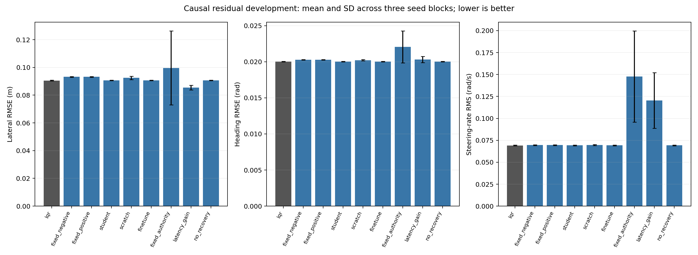

# Latency-Aware Residual Vehicle Control with Predictive Runtime Supervision

**Revised research draft; not publication-ready.** Numerical results below belong only to the identified campaign.

## Abstract

We evaluate bounded PPO residual assistance around a strong LQR baseline using a causal asynchronous execution interface and an explicit predictive supervisor. The supervisor combines packet freshness/validity, nominal cost comparison and recovery persistence. Matched constants and supervised initialization distinguish learning from filtering. Simulated-service tracking and actual process timing are reported separately. Formal safety, energy advantage and real-vehicle readiness are not established.

## Method

The command is clip(delta_LQR + w * residual, -0.5, 0.5). The worker returns a categorical proposal in {-0.08,-0.04,0,0.04,0.08}rad. Policy inputs exclude pending outputs, future completion and configured service duration. The local observer/LQR/supervisor executes independently of the worker; independence is a design requiring timing validation. The nominal predictor compares baseline and candidate commands over200ms, with a50ms candidate hold followed by LQR. A50ms observation-age cutoff rejects stale proposals; candidate weights are0.1/0.25/0.5 with0.05/tick increases and3 good control ticks for admission. Exact protocol.json defines reward, actuator, costs and settings.

## Evaluation

Six25k PPO pilots: three paired seeds, scratch versus causal supervised initialization; pretraining is extra. All episodes log true lateral/heading error, actuator movement, timing and rejection reason. The simple latency-gain arm is a disclosed reconstruction, not a published-controller reproduction.

| Method | Lateral RMSE (m) | Gain vs LQR | Survival |
|---|---:|---:|---:|
| lqr | 0.090578 | 0.000% | 96/96 |
| fixed_negative | 0.093213 | -2.909% | 96/96 |
| fixed_positive | 0.093213 | -2.909% | 96/96 |
| student | 0.090599 | -0.024% | 96/96 |
| scratch | 0.092441 | -2.057% | 96/96 |
| finetune | 0.090618 | -0.044% | 96/96 |
| fixed_authority | 0.099658 | -10.024% | 95/96 |
| latency_gain | 0.085469 | 5.640% | 96/96 |
| no_recovery | 0.090637 | -0.066% | 96/96 |

## Interpretation and limits

Development eligibility: False. All failed criteria are retained in decision.json. Known-path fresh noise is not unseen-road generalization. Whole training/noise pairs, rather than control ticks, are the independent comparison blocks. No arbitrary real-time, stability, GPU speedup or energy guarantee is inferred.

## References

Primary uploaded literature includes Wabersich and Zeilinger predictive safety filtering; Tearle et al. learning-based racing safety filtering; Cano Cordoba et al. delayed-observation shielding; Kalaria et al. delay-aware robust driving/racing; and Tabrizian et al. delay-aware merging. Exact publication metadata and a broader runtime-assurance review must be verified before submission.

## Development figure

