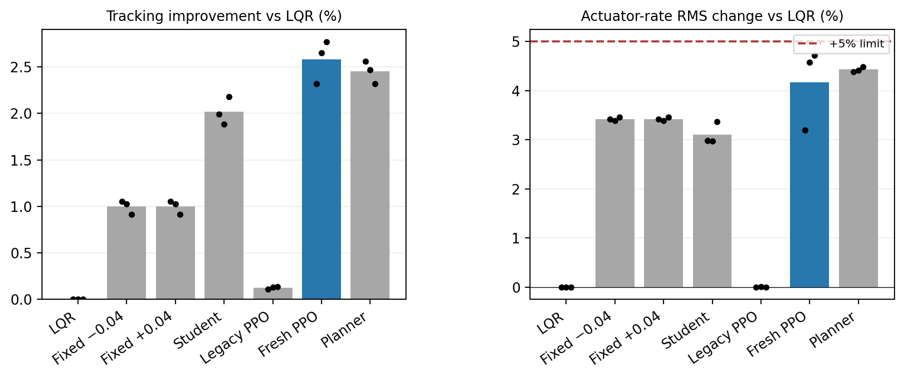

# LANS interface and computation correction report

27 October 2026 (Asia/Shanghai). Research evidence update; original campaigns are unchanged.

## Findings and implemented corrections

The old actor inference duration, packet age and monitor deadline were different quantities but the legacy authority function penalized packet age steeply. At 10 ms age, the 0.25 cap shrank to 0.00458, even if neural inference finished quickly. The old offline nominal case could return a proposal in the same tick, unlike a periodically polled worker. The fixed comparison now enforces at least one 10 ms delivery interval.
One predefined controller variant separates freshness eligibility from authority: a valid packet younger than 50 ms may receive up to 0.25 authority, with the existing 0.05/tick ramp,0.3 s residual filter, three-good-control-tick recovery,1 s nominal predictor and 0.1% predicted-cost improvement test. Invalid/stale packets immediately revoke assistance. This is an empirical performance supervisor, not a formal safety certificate.
For a valid packet, $f_t=f_{t-1}+\alpha[\operatorname{clip}(\Delta\delta_t,-0.08,0.08)-f_{t-1}]$, where $\alpha=1-e^{-0.01/0.3}$. Invalid/stale packets clear $f_t$, authority and the recovery count. Valid performance rejection keeps filter history while revoking authority.
$$\delta_{\mathrm{cmd},t}=\operatorname{clip}\left(\delta_{\mathrm{LQR},t}+w_t f_t,-0.5,0.5\right).$$
$$0\leq a_t<0.05\;\mathrm{s},\qquad J_0-J_1\geq\max(10^{-7},0.001 J_0).$$
After three consecutive good control ticks, $w_t=\min(0.25,w_{t-1}+0.05)$; otherwise $w_t=0$. Three control ticks need not contain three distinct worker replies. LQR always contributes: this is residual assistance, not full-command PPO/LQR switching.
The predictor array/BLAS work inside its 100-step recurrence was replaced by scalar equations, without fastmath or changed costs. Contracts checked 2,000 randomized cost pairs and 1,000 closed-loop command/state transitions against the frozen v3 implementation. The old controller remains separately available through scalar_aligned; the new authority variant is fresh_v4.
Fault injection was moved out of the monitor process. Stress helpers signal readiness before measured windows. Timing now records polling, sensing/LQR, feature construction, submission, supervision and software commit separately, and rechecks freshness/deadlines after fallback handling.
The existing 20-channel policy also omits the internal residual-filter state. The diagnostic constructed identical policy observations with different valid internal filter states and different next commands. Reachability of that exact pair is not proved: this shows a state-alias risk, not proof that it caused the measured learning gap. Adding a causal history feature requires a new versioned model/normalizer and matched training; old oracle fields were not silently repurposed.

## Fresh matched development comparison

Three paired model/noise groups,15/25 m/s, two paths, exact left/right mirrors and four service/mismatch conditions. All 672 episodes survived. Models are the unchanged original students and frozen v3 PPO endpoints; there are no new PPO training steps. Legacy and fresh PPO use the same actor weights. The planner uses current estimates, actuator, road preview and causal controller history; it never reads true friction, future noise or actual future completion. It is a finite nominal reference, not a global performance bound.

| Source | Tracking gain vs LQR | Heading change | Rate RMS change | Survival |
|---|---:|---:|---:|---:|
| LQR | +0.000% | +0.00% | +0.00% | 96/96 |
| Fixed −0.04 | +0.998% | -3.29% | +3.42% | 96/96 |
| Fixed +0.04 | +0.998% | -3.29% | +3.42% | 96/96 |
| Student | +2.017% | -0.30% | +3.11% | 96/96 |
| Legacy PPO | +0.126% | -0.05% | +0.00% | 96/96 |
| Fresh PPO | +2.579% | -0.51% | +4.17% | 96/96 |
| Planner | +2.450% | -6.28% | +4.43% | 96/96 |

PPO improves on the same-supervisor student by **0.573%**, below the frozen 1% margin. Every group gain is positive, but the complete screen remains **False**. Failed criteria: lacks 1% gain vs student.
The finite planner also fails the 1% student-margin screen. PPO already has better mean lateral RMSE than this particular planner, so distilling it or merely extending training is not justified by this diagnostic. This is not a proof that better learning or planning is impossible. Thresholds, seeds and operating regions were not altered after results; reserved evaluation stays unopened.
Independent audit replayed all **922,992** executed transitions, rewards, observer/plant states, filter/fusion decisions, policy queries and planner decisions. **144** 100 ms/LQR trajectory pairs matched exactly.

## Timing: faster computation does not establish a deadline guarantee

On 6,000 identical-input randomized-order cost pairs after warmup, median predictor time changed from 13.786 µs to 4.183 µs, approximately 3.30× for this kernel. This is not an overall LANS/PPO inference speedup. All raw samples, including outliers, are retained.
An independent preallocated native C heartbeat, with no PPO or controller, missed **80/3,000** deadlines on this unisolated host. It is scheduling context with a different workload, not a matched replacement for the controller. Some full-controller misses also contain computational/blocking time; no OS-only attribution is claimed.

| Controller | Missed original 10 ms deadlines | Functional checks | Nonzero correction ticks |
|---|---:|---|---:|
| Equivalent optimized v3 | 419/7500 | True | 979 |
| Freshness variant | 280/7500 | True | 602 |

Any miss fails strict observed timing. No targets were rebased, ticks dropped or misses forgiven. A finite zero-miss result would still not prove WCET or guaranteed 100 Hz. This cloud platform has no demonstrated real-time scheduling/isolation contract. Further timer tuning cannot establish a hardware guarantee.

## Actual worker stall and recovery

A separate prespecified test makes the actual worker wait 1 s for requests observed between 2 and 3 s, then restores healthy responses. Original observation times remain unchanged, late packets are rejected, and fresh local LQR continues in the fixed-step plant. Assistance must be exercised both before the stall and after healthy return; it is not forced on when prediction rejects a proposal.

| Actor seed | Assisted ticks before / after | Delayed packets | Deadline misses | Functional recovery |
|---|---:|---:|---:|---|
| 701 | 9/80 | 1 | 80/800 | True |
| 802 | 17/110 | 1 | 9/800 | True |
| 903 | 15/129 | 1 | 30/800 | True |

Overall recovery function: **True**. Recovery timing: **False**. These are separate outcomes.

## What remains

- Scientific: at least 1% PPO advantage over the same-supervisor student, with all other criteria preserved. The next justified research issue is causal filter-history/decision-time state and credit assignment, not blind training extensions. No new-model success is assumed.
- Execution: demonstrate the unchanged 10 ms deadline on a defined target system. Run the supplied Python 3.10 kit on the actual Windows/macOS laptop; cloud results cannot substitute for that run. Hard timing claims need a suitable execution/OS isolation design and worst-case evidence.
- Confirmation: reserved/unseen paths and selected-controller native Webots confirmation remain conditional on full selection and corresponding-controller timing pass. Historical native interface tests are not validation of this variant.
- Published comparison: the previous Wabersich–Zeilinger Eq 5/Algorithm 1 nominal specialization is retained. The supplied paper Algorithm 2 additionally needs validated model-error/confidence bounds and a terminal safe set/controller under its assumptions. These are not established for this noisy nonlinear plant; relabeling the nominal comparator as a full robust reproduction would be incorrect. The five supplied-source reference entries are verified; broader bibliography/prior-art verification remains incomplete.
- Physical: actual sensors, communication and actuator response require connected hardware. Software-plant state advances by 10 ms per iteration; survival does not establish continuous physical safety during host stalls.
- Publication: the evidence draft is updated, but full novelty, formal safety and submission readiness remain unestablished. No 49× speedup, energy, blind-distance or global stability claim is restored.

The downloadable kit is a software-plant research diagnostic with actual frozen PPO actors, not vehicle deployment approval. Source/model hashes, protocols, raw traces and verifiers accompany the report. Existing failed studies remain unchanged.

## Supplied-paper reference entries and comparison limits

# Version-specific primary-source bibliography

Verified against the five PDFs supplied by the author, not inferred publisher
metadata or search snippets. Preprints are cited as the actual supplied versions;
no unverified journal year, volume, DOI or publication status is added. This
completes these five reference entries, not a systematic literature search or an
audit of every citation in the original manuscript.

1. B. Tearle, K. P. Wabersich, A. Carron, and M. N. Zeilinger, “A predictive safety
   filter for learning-based racing control,” arXiv:2102.11907v1, 23 February 2021.
   Title, authors, identifier and date appear on the supplied first page.
2. F. Cano Córdoba, A. Palmisano, M. Fränzle, R. Bloem, and B. Könighofer,
   “Safety Shielding under Delayed Observation,” in *Proceedings of the
   Thirty-Third International Conference on Automated Planning and Scheduling
   (ICAPS 2023)*, pp. 80–85, 2023. Conference title/year are in the first-page
   header; the supplied six-page proceedings article has page numbers 80–85.
3. K. P. Wabersich and M. N. Zeilinger, “A predictive safety filter for
   learning-based control of constrained nonlinear dynamical systems,”
   arXiv:1812.05506v4, 17 May 2021. This is the version used for the disclosed
   nominal Eq. (5)/Algorithm 1 specialization in reviewer-followup-v2.
4. D. Kalaria, Q. Lin, and J. M. Dolan, “Delay-aware Robust Control for Safe
   Autonomous Driving and Racing,” arXiv:2208.13856v1, 29 August 2022. The supplied
   masthead says *IEEE Transactions on Intelligent Vehicles*, not *IEEE
   Transactions on Control Systems Technology*. It does not independently verify
   final volume/year/DOI; the citation therefore uses the verified arXiv version.
5. A. Tabrizian, Z. Huang, A. Aziz, and P. Wei, “Delay-Aware Reinforcement Learning
   for Highway On-Ramp Merging under Stochastic Communication Latency,”
   arXiv:2403.11852v5, 27 May 2026. The supplied version reports DAROM; results or
   titles from an older version must not be silently substituted.

## What their results establish relative to LANS

| Reference | Primary evidence relevant to LANS | Comparison boundary |
|---|---|---|
|1| Predictive filtering, backup trajectories, an 80 Hz implementation and 1:28-scale physical vehicle experiments | Stronger physical/formal evidence than current LANS; its rate is not an inference-speed comparison |
|2| Safety games/shielding under delayed observations, including CARLA examples | Observation delay differs from delayed PPO-worker availability with fresh local sensing |
|3| Predictive safety filtering with backup/terminal constructions and uncertainty treatment | LANS has only a disclosed nominal specialization; its uncertified LQR fallback is not their theorem |
|4| Vehicle computation/actuator-delay handling, robust control and learned-command guarding | Close application overlap; LANS cannot claim that delay-aware supervision itself is new |
|5| SUMO on-ramp merging, delay-aware encoding and physics-based fallback;99.80% success in the reported high-density 2 s communication-delay condition | Different task, algorithm and delay mechanism; this percentage cannot rank against LANS tracking RMSE |

No one of these numerical results ranks LANS as “#1.” A matched implementation,
common task/plant, sensing and actuator assumptions, compute resource, training
budget, seeds and delay mechanism would be required. Formal guarantees also
cannot be compared using empirical survival alone. These verified entries should
replace inconsistent metadata for these five works in a revised bibliography.

## Claims that still require evidence

- Reproduction of the complete robust published algorithms/authors code.
- A broader up-to-date prior-art search, including original residual-RL and
  Simplex/runtime-assurance primary references.
- Any claimed novelty, formal safety, physical readiness or universal ranking.
- Every other entry and in-text citation in the original manuscript.

Full uploaded PDFs are not republished in this repository.

