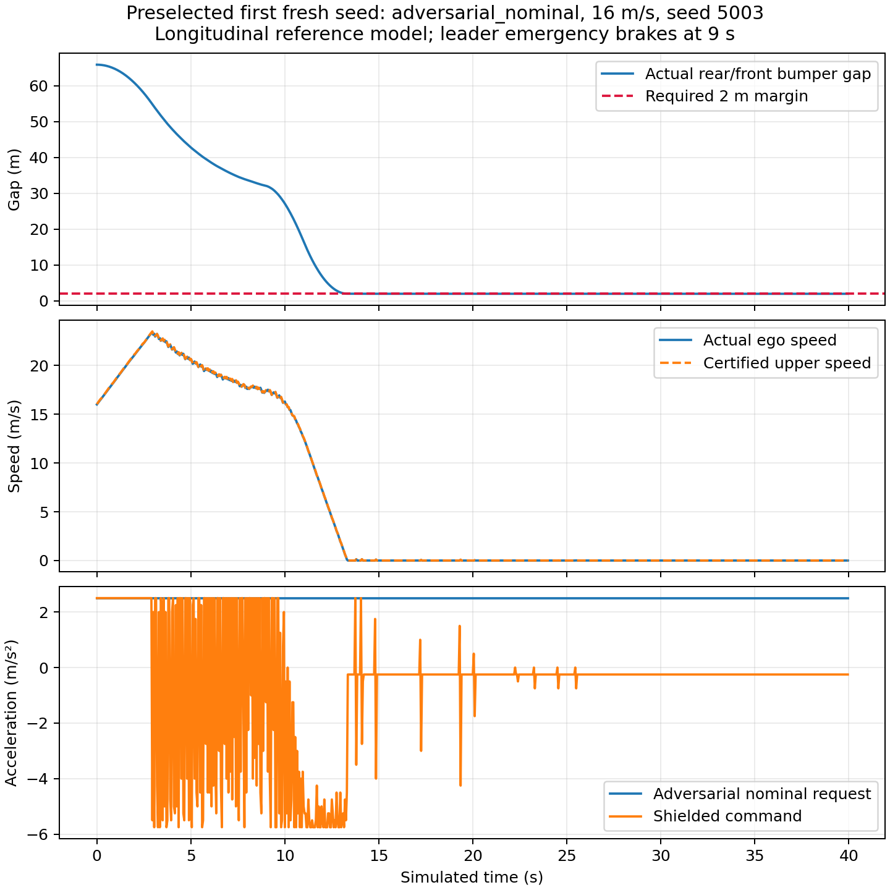
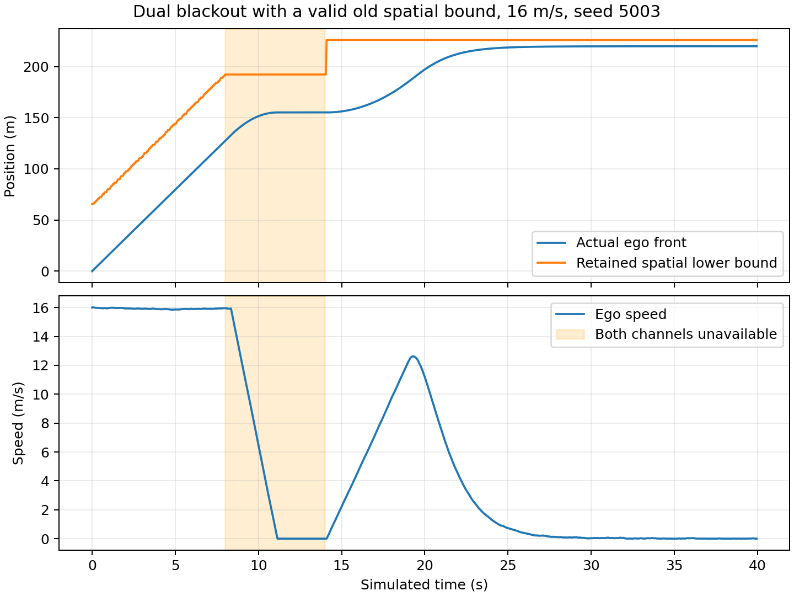

# Abstract {-}

Connected vehicle following must handle both physical stopping constraints and
unreliable information. A vehicle that continues following an expired message may
accelerate towards a stopped predecessor, while a vehicle that interprets silence
as departure may select a farther target prematurely. Conversely, conservative
braking can avoid a sampled collision while preventing useful formation recovery.
This thesis studies these distinctions within the LANS simulation framework.

The work combines an existing observation-driven V2V/radar architecture with a new,
separately scoped longitudinal safety supervisor. The communication architecture
preserves original observation ages, rejects replayed information and supports
radar fallback, positive departure evidence and bounded cooperative observations.
Its broader Python/Webots evidence is empirical. The new supervisor instead uses
valid position/speed intervals, a non-reversing obstacle contract and a recoverable
stopping invariant. It accepts an arbitrary nominal acceleration only when a
one-step guard preserves sufficient distance for guaranteed emergency braking.
Old obstacle observations are retained as spatial lower bounds without being
relabeled as fresh dynamic state.

An analytical inductive argument establishes longitudinal bumper separation under
explicit assumptions. Twelve real-arithmetic proof obligations are checked by a
pinned SMT solver, with five satisfiable negative controls. A separate stdlib
auditor verifies every reference trajectory using exact rational arithmetic and
checks minimum separation throughout each control interval. The completed study
contains 72 development and 240 fresh reference episodes, 249,600
control intervals, and 2,160 deterministic boundary cases. The fresh cohort's
minimum continuous bumper gap is 2.000022426 m against a 2 m requirement.

The guarantee is conditional on initial recoverability, complete relevant-object
coverage, bounded sensing and actuation, non-reversal and timely execution. It is
not a proof for arbitrary lateral cut-ins, the existing two-dimensional Webots
plant, unbounded Gaussian errors, physical vehicles or stable formation convergence.
The thesis provides a reproducible simulation-based safety argument without
claiming real-world certification or comparative controller superiority.

# Introduction

## Research problem

V2V communication increases the information available to a following vehicle, but
message reception is not identical to knowledge of the current physical state.
Delay, loss, duplication, reordering and replay can cause a controller to operate
on obsolete geometry. Radar supplies an independent local observation, yet it can
also miss, occlude or ambiguously associate a vehicle. When neither source is
available, the controller must decide what information remains valid and what
action is still defensible.

The problem is especially important when another vehicle enters or leaves a
formation. Target identity, physical collision avoidance, information freshness
and desired spacing are related but distinct properties. Successful association
does not imply small spacing error. A safe stop does not imply successful
formation recovery. A zero-collision sample does not establish a universal theorem.

This thesis asks how LANS can express and verify a useful conditional safety
claim without physical hardware, while preserving the limitations of its existing
simulation evidence. It deliberately narrows the provable dynamics rather than
assuming that a complex perception and vehicle stack inherits a stopping formula.

## Questions and contributions

The research questions are: (1) what collision-avoidance property can be guaranteed
under a declared longitudinal model; (2) what information remains usable when
communications fail indefinitely; (3) how can verification and simulation check
the relation between the written argument and executable reference code; and
(4) which assumptions block extension to the broader LANS/Webots system?

The contributions of this research package are:

1. A documented assume–guarantee contract separating physical, sensing,
   communication, initialization and execution premises.
2. An exact-rational acceleration supervisor with a recursively feasible emergency
   candidate and explicit per-command certificates.
3. An analytical invariant proof, 12 solver-checked algebraic obligations and
   counterexamples to deliberately weakened premises.
4. Source-frozen, independently audited development/fresh validation campaigns,
   including negative diagnostics and complete raw evidence.
5. A clear account of which broader empirical LANS results remain outside the proof.

These are implementation and verification contributions within this repository.
Stopping-distance guards, supervisory filtering and invariant reasoning have
substantial prior literature; this draft does not claim their invention.

## Scope

This is a simulation-based research thesis draft. It does not contain hardware
experiments, institutional approval or a deployed-vehicle safety case. Official
institution, degree, student number, declarations and supervisor information must
be supplied by the author before institutional submission. The final thesis
benchmarking and comparative performance study remain on hold as instructed.

# Related work and positioning

Predictive safety filtering separates a nominal proposal from the constraints
under which that proposal may be applied. Wabersich and Zeilinger's inspected
2021 manuscript describes filtering under model-confidence, stabilizability and
terminal-safety conditions. Tearle and colleagues apply predictive filtering to
vehicle racing, with vehicle dynamics and backup/terminal reasoning. Their
physical demonstration does not transfer a hardware guarantee to LANS.

Delayed-observation shielding is also established. Cano Córdoba and colleagues
study finite safety games under bounded FIFO observation delay. Their model and
winning-strategy abstraction differ from the continuous stopping envelope here.
Kalaria and colleagues study delay-aware vehicle control with explicit actuation
and computation-delay treatment. A current-state or instantaneous-action model
cannot silently be presented as solving those different delay channels.

The inspected 2026 version of Tabrizian and colleagues' DAROM manuscript considers
communication latency in merging with immediate actions and current ego sensing.
Its use of history and a stopping override further demonstrates that a stopping
guard alone is not a novelty claim. The present work concentrates on retained
spatial bounds, reference implementation correspondence and explicit conditional
scope, without ranking results from incompatible tasks.

The repository's primary-paper ledger identifies the exact five inspected versions
and unresolved publisher metadata. This draft reuses that verified review rather
than inventing final DOI/venue details. It is not an exhaustive recent-literature
search. No reviewed controller has been reproduced as a matched benchmark here.

# LANS architecture and evidence boundaries

## Communication and observation path

The existing LANS V2V endpoint tracks neighbours and original observation times,
rejecting future, expired, replayed and regressing packets. The following stack
uses fresh radar or V2V state, with braking when usable knowledge is missing.
Anonymous radar tracks may acquire a connected identity only through a unique
association. Positive observations, rather than absence alone, support departure.
Connected observers can forward bounded original beacons and share their own
anonymous radar observations. Non-connected actors do not transmit invented state.

The broader robustness stage tests curved and two-lane roads, dense traffic,
non-connected actors, noisy/missed/occluded returns and communication failures.
The ego's target choices are observation-driven; NPC traffic manoeuvres are fixture
scripts. Webots uses native sensing and communications, without other vehicles'
Supervisor positions entering ego control. These properties make useful empirical
evidence, while not establishing all perception or physical-model assumptions.

## Existing empirical results

At parent checkpoint `9daa1487`, 146 automated tests, 240/240 fresh Python trials
and 36/36 fresh native trials under an explicit 300 m radio configuration passed
their declared gates. The separately retained 150 m native cohort passed 35/36;
one head vehicle left all available radio paths. The 300 m cohort uses different
fresh seeds and does not establish a causal controller improvement at 150 m.

Target return and headway settling remain different outcomes. One broader Python
trial did not demonstrate its separate continuous one-second stable-return window.
Conditional spacing RMS reached 187.36 m in Python and 136.56 m in native 300 m
trials. These limitations are retained; this thesis does not redefine those gates
or relabel large gaps as settled formation.

## New proof boundary

The new shield is a separate longitudinal reference component. Its nominal law
uses exact decimal versions of the LANS damped gains, $k_p=0.64$, $k_v=0.832$,
standstill gap 6 m and time headway 1.2 s. A test checks their numerical correspondence
to the existing configuration. This is not unchanged execution of the entire
`RobustFollower`/bicycle stack. The proof tolerates arbitrary nominal proposals;
it does not depend on the nominal law being stable or intelligent.

The old experiments use Gaussian sensor errors, idealized local poses, curved
geometry and native speed servos. None automatically satisfies the new deterministic
interval/actuation contract. Their existing results are contextual empirical
evidence, not formal validation of the new theorem.

# Conditional safety formulation

## Coordinates and assumptions

Let $x(t)$ denote the follower front-bumper station and $p_i(t)$ the rear-bumper
station of protected obstacle $i$ on one fixed straight corridor. The safety
property is $p_i(t)-x(t)\ge m$, where $m>0$. A coordinate adapter must account for
vehicle length. The reference examples choose $m=2$ m.

Six assumptions delimit the theorem:

1. Every collision-relevant forward object is protected. There are no hidden
   intrusions, lateral/rear collisions or route changes. New object admission
   requires the invariant to hold before that object becomes collision-relevant.
   Admissions occur at update boundaries, before the guard is evaluated; an
   asynchronous intrusion needs prior protection or an immediate safety update.
2. Ego upper bounds $X\ge x$ and $V\ge v\ge0$ and associated object lower bounds
   $L_i\le p_i(t_{obs})$ are valid. Sensor and identity errors are bounded/trusted.
3. Protected obstacle rear positions are nondecreasing. An obstacle can brake
   immediately or stop, but cannot reverse towards the follower.
4. A command $u$ yields a valid upper acceleration $a=u+\delta$ and a non-reversing
   ego flow envelope. The reference uses fixed update intervals $h$; a command
   may not be held longer than its certified interval.
5. Initial and newly admitted bounds satisfy recoverability. Unknown free space
   and an initially unavoidable collision do not satisfy this condition.
6. The guard is obeyed using valid arithmetic and retained memory. A different
   numeric representation or vehicle plant needs a separate refinement argument.

The example model chooses $b=5.5$ m/s² guaranteed braking, acceleration uncertainty
$\delta=0.25$ m/s², $h=0.05$ s, and emergency command $u_E=-b-\delta=-5.75$ m/s².
These are declared model choices, not measured vehicle specifications. The simulated
time grid is not a measured hard wall-clock deadline guarantee.

## Non-reversing flow envelope

For initial upper speed $V$ and constant acceleration upper bound $a$, define

$$W(V,a,t)=\max(0,V+at).$$

If $a<0$ and $t>V/(-a)$, define $S(V,a,t)=V^2/(-2a)$; otherwise

$$S(V,a,t)=Vt+\tfrac12at^2.$$

The comparison lemma bounds actual speed by $W$ and displacement by $S$. For
moving non-reversing dynamics, integrate the acceleration upper bound until the
upper trajectory stops, and then apply zero-speed saturation. Consequently $S$
is nondecreasing in time. This analytical flow lemma is separate from Z3's
algebraic checks; Z3 is not solving the original vehicle ODE.

## Retained spatial information

A valid measured rear position $z_i$ with error bound $e_i$ supplies
$L_i=z_i-e_i$. Non-reversal gives $p_i(t)\ge L_i$ for all later times. Multiple
valid bounds for the same object may be combined with their maximum. This remains
sound after the observation expires for nominal following: its timestamp is not
changed and its speed is not extrapolated optimistically. A constant old lower
bound may eventually force the follower to stop, which is an intended safety cost.

Freshness and replay checks only govern admission of messages. They cannot prove
that a sender is honest, a sensor bound is valid or an identity is correct. Those
remain explicit premises. Unbounded Gaussian noise cannot establish deterministic
containment simply because no large error appeared in finite trials.

## Invariant and command guard

Let $B=\min_i L_i$. Maintain

$$Q=2b(B-X-m)-V^2\ge0.$$

For a candidate $u$, compute $s=S(V,u+\delta,h)$ and $w=W(V,u+\delta,h)$. Accept
the command only if

$$2bs+w^2\le2b(B-X-m). \tag{1}$$

The reference enumerates a finite command grid up to the clipped nominal request,
always including $u_E$. Exact fractions avoid floating-root rounding at the safe
boundary. The criterion reserves the travel in the next interval and the complete
emergency stopping distance afterwards, even if the obstacle does not move at all.

# Safety argument and mechanical verification

## Emergency feasibility

For $u_E$, the upper acceleration equals $-b$. If $V\ge bh$, then
$s=Vh-bh^2/2$ and $w=V-bh$, so $2bs+w^2=V^2$. If $V<bh$, the follower stops
inside the interval: $s=V^2/(2b)$ and $w=0$, giving the same identity. Since
$Q\ge0$, the emergency candidate always satisfies (1). The enumeration therefore
contains a feasible command whenever initialization/admission is admissible.

## Inductive preservation

Set $X^+=X+s$ and $V^+=w$. Valid non-reversing obstacle memory implies $B^+\ge B$.
Equation (1) then yields

$$(V^+)^2\le2b(B^+-X^+-m).$$

Additional valid current ego bounds may intersect the predicted interval; reducing
$X^+$ or $V^+$ cannot increase stopping demand. A new obstacle is different: its
admission requires the invariant to hold for its own lower bound. Previous safety
with a farther leader does not establish safety for an arbitrary close cut-in.

## Separation between updates

For every $0\le t\le h$, ego displacement is at most $S(V,a,t)\le s$, while every
protected obstacle remains at or beyond $B$. Equation (1), with $w^2\ge0$, gives
$B-X-s\ge m$. Therefore

$$p_i(t)-x(t)\ge B-X-S(V,a,t)\ge m.$$

This covers the complete interval rather than merely the logged endpoints.
Combining emergency feasibility, invariant preservation and interval separation
proves the property by induction for all updates while the assumptions hold.
Arbitrarily long V2V/radar loss does not invalidate a valid retained spatial bound;
it may instead produce an indefinite stop. Progress is not a theorem conclusion.

## Machine-checked scope and trust

The pinned `z3-solver==4.13.3.0` package checks 12 negated quantifier-free nonlinear
real-arithmetic obligations, requiring UNSAT. Exported SMT-LIB scripts cover both
stopping branches, emergency feasibility, guard preservation, interval separation,
valid bound refinement/retention and measurement containment. Five deliberately
weakened scenarios must return SAT: unguarded acceleration, a missed deadline,
unsafe initialization, obstacle reversal and invalid measurement containment.

The complete argument combines these algebraic results with the analytical flow
lemma and induction above. It is not a proof-assistant-kernel certificate, formal
verification of all Python source, a two-dimensional reachability theorem or a
physical-world safety proof. The trusted base includes the stated model, written
argument, SMT solver, rational runtime, operating system and input adapters.

# Experimental method

## Reference simulation

The new study uses non-reversing longitudinal motion with exact rational arithmetic
and a 0.05 s interval over 40 s. Position/speed observations have declared bounded
errors: ego 0.05 m and 0.05 m/s, radar rear position 0.15 m, radio rear position
0.10 m and observed obstacle speed 0.08 m/s. Errors are sampled within these
bounds, not generated by clipping a Gaussian and calling the result unbounded.
Actual held acceleration differs from its command within $\pm0.25$ m/s².

An input generator supplies delayed/lost/duplicated measurements with original
timestamps. The controller receives these observations and ego bounds; fixture
truth is reserved for generation and independent scoring. Radar and radio TTLs
are 0.2 and 0.4 s. Valid spatial memory is retained even when nominal state expires.

Eight profiles cover steady following, emergency leader braking, V2V blackout,
dual blackout, bounded sensing error, admissible object entry, adversarial nominal
acceleration and permanent target-observation blackout. The admissible-entry
profile is a one-dimensional admission test. It is not formal verification of
autonomous two-dimensional lane-entry detection.

## Data separation and acceptance

The fixed speed grid is 8/12/16 m/s. Development seeds are 4001, 4003 and 4007.
Ten fresh seeds are 5003, 5009, 5011, 5021, 5023, 5039, 5051, 5059, 5077 and 5081.
Source files, assumptions and seeds are frozen before opening validation. The
validation command requires passed development, independent replay, boundary and
theorem evidence. Changing active sources invalidates the gate. Failed outputs
are retained instead of overwritten.

Every valid episode must satisfy sensor containment, replay/freshness semantics,
actuator bounds, upper-state propagation, the exact invariant/guard and a continuous
minimum bumper gap of at least 2 m. There is no arbitrary progress requirement:
a permanently unobservable target can require stopping. Progress, stopped time
and nominal spacing error are still reported so that conservatism remains visible.

## Independent audit and negative evidence

The separate auditor imports no controller, plant, Z3 or NumPy. It reconstructs
motion and certificate inequalities with stdlib rational arithmetic. Each gap is
piecewise quadratic; its exact minimum is evaluated at endpoints, stopping times
and interior zero-relative-speed points. Thus positive endpoint gaps cannot hide
an interior overlap. A dedicated test demonstrates this counterexample.

Boundary checks cover 2,160 combinations of speed, braking, interval, uncertainty,
nominal request and available slack, including exact equality and zero-speed
branches. Semantic corruption tests modify a sensor value, an unsafe guard or a
plant transition and update ordinary trace hashes before checking rejection.
Outside-contract diagnostics intentionally admit a too-close stationary cut-in or
weaker-than-assumed braking. Their collisions demonstrate why premises matter;
they are not counted as successful valid-cohort trials.

# Results

## Verification outcomes

| Evidence | Result |
| --- | --- |
| Algebraic SMT obligations | 12/12 UNSAT |
| Deliberately weakened SMT controls | 5/5 SAT |
| Exact boundary cases | 2160/2160 passed |
| Independent development episodes | 72/72 passed |
| Independent fresh episodes | 240/240 passed |
| Rehashed semantic corruptions | 3/3 rejected |
| Automated repository V2V tests | 164 passed |

The fresh cohort comprises 240 episodes and 192,000 intervals. The
minimum exact continuous gap, formatted in decimal, is 2.000022426 m; no valid
episode violates the 2 m requirement. The supporting development minimum is
2.000204813 m. These are outcomes in a bounded-error reference model, not
estimated physical-world collision probabilities.

## Safety and performance together

| Profile | Runs | Minimum continuous gap (m) | Maximum spacing RMS (m) | Maximum stopped time (s) | Median progress (m) |
| --- | ---: | ---: | ---: | ---: | ---: |
| Steady connected | 30 | 48.191046 | 45.256 | 0.00 | 475.772 |
| Emergency brake | 30 | 6.049214 | 22.390 | 20.35 | 167.275 |
| V2V blackout | 30 | 48.191046 | 46.238 | 0.00 | 472.904 |
| Dual blackout | 30 | 6.082835 | 35.537 | 17.25 | 167.257 |
| Bounded error | 30 | 11.437291 | 26.306 | 0.00 | 403.515 |
| Admissible entry | 30 | 14.004791 | 19.342 | 0.00 | 433.845 |
| Adversarial request | 30 | 2.000022 | 11.218 | 28.65 | 171.349 |
| Permanent blackout | 30 | 48.191046 | 292.207 | 30.35 | 111.685 |

Permanent blackout can create long stopped intervals and large nominal spacing
errors. These outcomes are disclosed rather than hidden behind a collision-free
label. The theorem promises separation under its assumptions, not sustained motion
or convergence to 1.2 s headway. The maximum fresh-reference spacing RMS is
292.207 m and maximum stopped time is 30.35 s.

Representative profiles and the first fresh seed were chosen by a fixed rule,
not selected for the smallest spacing or best-looking run.

## Deliberately invalid assumptions

With a 16 m/s follower and a stationary object only 1 m ahead, even immediate
5.5 m/s² braking produces an overlap in the excluded diagnostic. Likewise,
initialization using 5.5 m/s² braking does not protect a plant that can supply only
2 m/s². The exact reference diagnostics report negative minimum gaps of
-22.272727 m and -38.727273 m respectively. The initialization check rejects
the unsafe cut-in before issuing a certificate. These examples do not contradict
the theorem because initial recoverability or the braking premise is false.

# Discussion and validity

## What hardware-free evidence establishes

A conditional mathematical safety statement can be developed and checked without
real hardware. Its value is precision: a reviewer can inspect the assumptions,
reproduce the algebraic checks and challenge the correspondence between the model
and code. Independent exact interval checks are stronger than checking sampled
collision flags alone. None converts assumed sensor/braking limits into measured
physical facts.

The reference proves a narrow property across a broad class of non-reversing
leader motion. It is deliberately conservative because it credits no future leader
displacement. This allows indefinite communication loss, but can cause a stop well
before a moving leader. An efficiency-oriented extension would need additional
valid reachable-set information and its own proof, rather than an optimistic
extrapolation from a stale velocity.

## Limits of transfer

The 2-D LANS architecture contains lateral motion, route projection, association,
Gaussian errors and native actuation. Extending this theorem requires valid
collision-corridor occupancy bounds, bounded pose/range/identity errors, a proved
actuation/coordinate refinement and an admissible entry/release protocol. A
two-dimensional cut-in can invalidate coverage before any longitudinal guard acts.
An object genuinely unobservable within unavoidable stopping distance cannot be
made safe by a software claim. Cryptographic authentication and adversarial sensor
claims are also outside the current contract.

Deadline misses are not repaired by retaining a safe old command indefinitely.
The reference propagates bounds over exactly $h$ and is tested on that fixed grid.
Holding beyond $h$ is uncertified. A variable-period port must propagate bounds
at its actual elapsed interval; an early call cannot reuse the full-$h$ predicted
speed during braking as a current upper bound. The theorem requires valid current
bounds, and the fixed-grid evidence does not establish this implementation port.
Measured real-time behaviour, bounded actuation latency and numerical-portability
analysis would be needed for a concrete executable deployment.

The command grid permits abrupt acceleration changes. No comfort, jerk or
acceleration-rate property is proved. Applying an output rate limiter can remove
the emergency action and invalidate recursive feasibility; such an extension
needs a new argument rather than an unverified smoothing step.

## Statistical and research limits

The fresh seeds sample one declared synthetic distribution. Repeated time ticks
are correlated; they must not be counted as independent trials for a collision
probability confidence bound. Zero observed events, even in independent trials,
does not establish zero risk. The mathematical argument, empirical support and
physical validation are different evidence categories.

The related-work review is version-specific and not exhaustive. No theorem
superiority, published-controller ranking or learned-policy advantage is claimed.
Earlier failed/invalid development and the 150 m diagnostic remain available.
Final thesis benchmarking is an explicitly held activity.

# Conclusions and further work

This work supplies a hardware-free conditional safety package for longitudinal
V2V-assisted following. Its exact-rational supervisor maintains an emergency
stopping invariant, preserves old spatial information without refreshing state
timestamps and provides a feasible backup under a declared contract. The written
inductive proof, SMT obligations, independent interval audit and complete reference
evidence form a reviewable safety argument.

The result does not certify the broader vehicle/perception stack. Formation
spacing, recovery under lost connectivity, arbitrary lane entry, deadline bounds
and physical refinement remain separate research problems. The next theoretical
step is an independently verified 2-D occupancy/admission abstraction and a
bounded-error refinement to the selected vehicle plant. Hardware validation, if
later pursued, would measure rather than assume the physical contract.

# Reproducibility appendix

The implementation is under `integrations/connected_v2v/conditional_safety`.
`THEOREM.md` is the detailed contract/proof; `prove.py` exports SMT-LIB; `shield.py`
is the exact reference; `audit.py` is independent; `study.py` enforces the staged
source freeze. `PROTOCOL.md` records the predeclared design. The README contains
commands and archive/extraction instructions. Source hashes, all raw development
and fresh-validation trajectories, proof scripts, negative checks and per-profile
tables are archived with SHA-256 member checksums.

The working checkpoint passed 164 automated tests. The solver is pinned to
`z3-solver==4.13.3.0`; Python is 3.10.22. Plots use the prepared pinned Matplotlib
environment. No paid service, learned-policy training or physical hardware is
required. Build the English Markdown, PDF and editable Word draft from the same
source so that mathematical claims and result tables remain consistent.

The manuscript is a research draft. Institutional formatting/front matter,
supervisor review and any final comparison remain separate from producing and
verifying this package. Existing opening reports are preserved unchanged.

# References {-}

The following are the exact versions already inspected in the repository's
primary-source review; publisher metadata is not guessed here.

- Kalaria, D., Lin, Q., and Dolan, J. M. *Delay-aware Robust Control for Safe
  Autonomous Driving and Racing*. arXiv:2208.13856v1, 2022.
- Tearle, B., Wabersich, K. P., Carron, A., and Zeilinger, M. N. *A predictive
  safety filter for learning-based racing control*. arXiv:2102.11907v1, 2021.
- Wabersich, K. P., and Zeilinger, M. N. *A predictive safety filter for
  learning-based control of constrained nonlinear dynamical systems*.
  arXiv:1812.05506v4, 2021.
- Cano Córdoba, F., Palmisano, A., Fränzle, M., Bloem, R., and Könighofer, B.
  *Safety Shielding under Delayed Observation*. ICAPS 2023, pp. 80–85.
- Tabrizian, A., Huang, Z., Aziz, A., and Wei, P. *Delay-Aware Reinforcement Learning for Highway On-Ramp Merging
  under Stochastic Communication Latency*. arXiv:2403.11852v5, 27 May 2026.
- Z3 project. *Z3 theorem prover*, official source repository:
  <https://github.com/Z3Prover/z3>. Runtime package used here:
  `z3-solver==4.13.3.0`. Its role is the stated SMT obligation check.

The existing bibliography and page-level review are in
`docs/research/primary-papers/references.bib` and its companion `README.md`.
