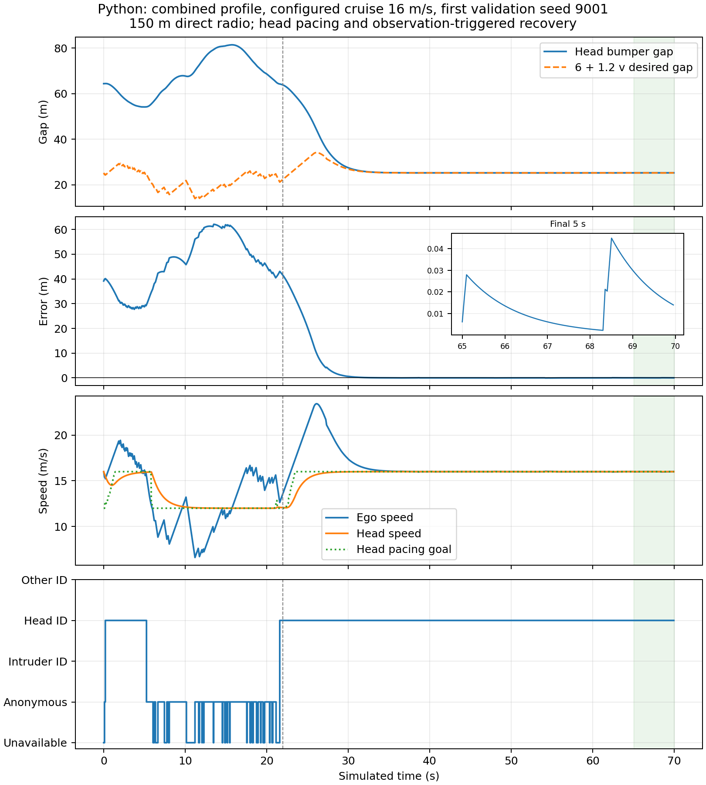
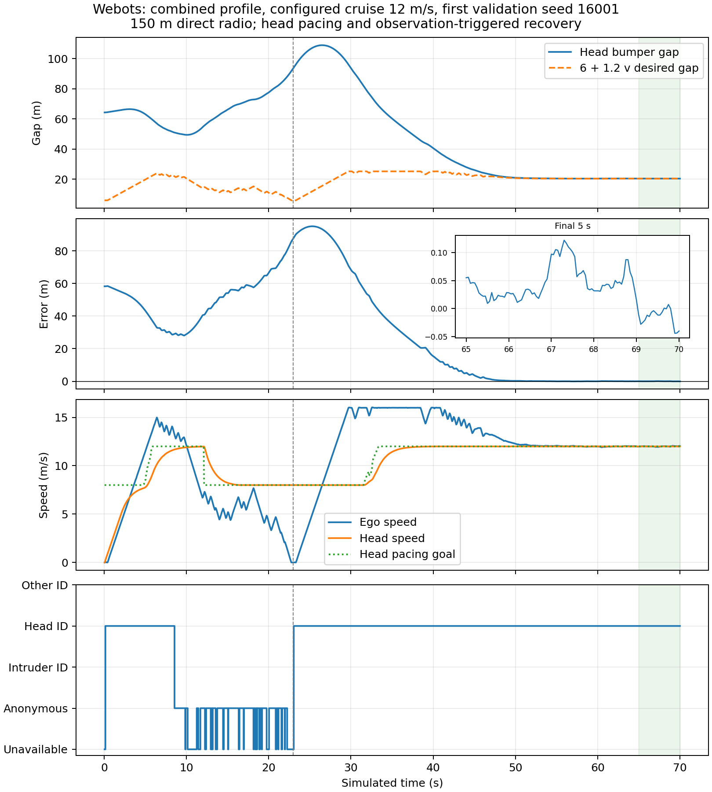
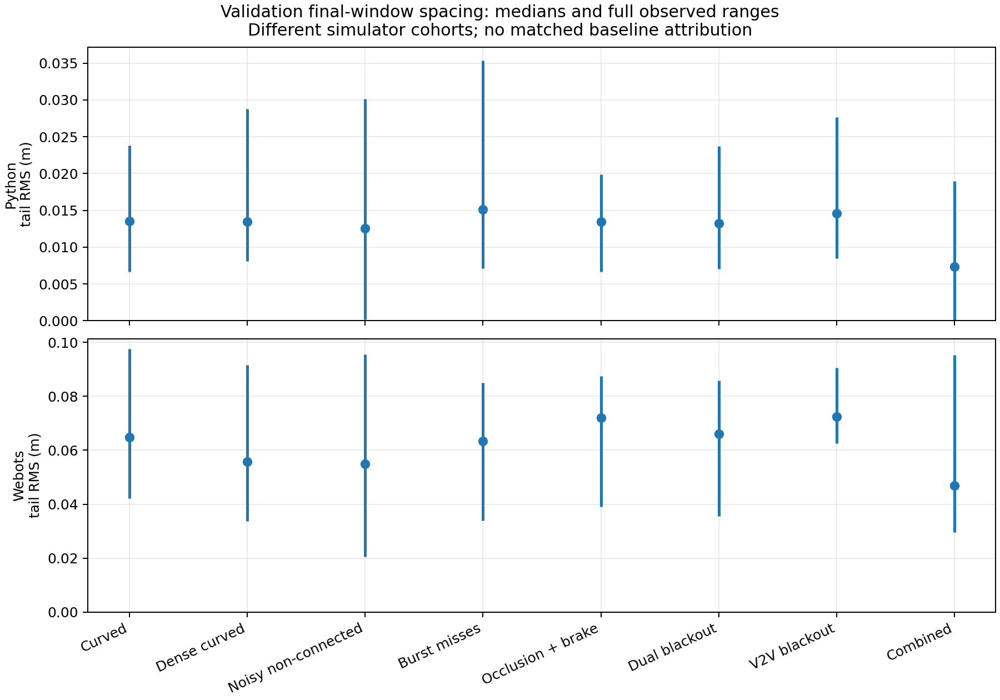

# Abstract {-}

Connected following depends on both braking capability and the quality of the
information used to choose a predecessor. Communication loss must not be confused
with a vehicle leaving the lane, and collision avoidance alone does not imply
that a formation returns to its desired spacing. This thesis develops and audits
a hardware-free simulation study of those distinct properties in LANS.

The implementation combines original-time V2V messages, anonymous radar
observations, observation-driven target association, conservative braking and
positive-departure recovery. The final architecture adds route-normal steering,
measured recovery modes, bounded cooperative head pacing and priority relaying
within the original 150 m direct-link range. Performance is evaluated with
consecutive two-second sampled association and settling windows, meaningful progress,
final-window spacing and speed errors, and restoration of head cruise speed.

The final fresh cohorts pass 240/240 Python and 80/80 native Webots episodes across eight profiles. The worst final-five-second spacing RMS is 0.035396 m in Python and 0.097552 m in Webots, with no censored two-second stable head returns. Separate unreachable cases remain ordinary recovery failures with expected braking. Failed earlier cohorts are preserved.

Two mathematical claims are kept separate. An earlier one-dimensional reference
supervisor preserves a stopping invariant prospectively under explicit sensing,
admission, braking, timing and non-reversal assumptions. The broader result
certifies completed two-dimensional trajectories continuously between logged
endpoints under declared body, pose, acceleration and yaw bounds. It includes
curves, lateral cut-in/out, non-connected actors and actual simulated Webots
motion, without assuming that commanded acceleration equals physical response.
It is an a posteriori finite-trace result, not prospective invariance of the
entire controller. No hardware or unconditional real-world safety claim is made.
Final comparative benchmarking remains on hold.

# Research problem and contribution

## Safety, information and useful recovery

A connected follower may receive delayed, lost, duplicated or replayed messages.
Radar can supply a fresh relative observation when radio is unavailable, but can
also miss a vehicle because of occlusion, bearing limits, noise or scan latency.
If both sources become unavailable, extrapolating an expired state indefinitely
can cause an unsafe decision. Conversely, always braking on uncertainty may
leave a stopped follower while the head travels outside every communication path.

An autonomous predecessor selector must distinguish a positively observed lane
departure from silence. It must also distinguish a plausible predicted intrusion
from evidence that an anonymous object is already a member of the lane. The
controller can brake for an uncertain approaching object before admitting that
object as the selected predecessor. This distinction matters because a false
admission followed by missing observations can leave a permanent ghost target.

The thesis therefore treats four properties separately: fresh admissible
information, physically collision-free motion, correct stable association and
formation convergence. A safe stop can satisfy the second property while failing
the fourth. An isolated correct association sample does not establish stability.
A small error after a long transient does not establish a small whole-run error.

## Questions answered by the study

1. Can observation-triggered recovery reduce excessive following gaps while
   retaining conservative approach braking and the original freshness rules?
2. Under the original 150 m communication range, can causal head pacing and
   bounded relaying retain useful recovery paths in the declared scenarios?
3. Does recovered association remain correct and fresh at every control tick, and does
   formation spacing settle while the head returns to its cruise speed?
4. What conditional mathematical statement can be made about the broader curved,
   lateral and native-simulator trajectories without physical hardware?
5. Can the reported outcomes be reconstructed from complete raw evidence,
   frozen execution source, independent scores and explicit failure history?

The contribution is the integrated implementation and its evidence boundary.
Stopping guards and safety filtering are established techniques; their use alone
is not a novelty claim. No reviewed controller has been reproduced as a matched
baseline in this work. The experiments do not establish superiority over other
methods or deployment readiness.

## Related work

Predictive safety filtering separates a nominal proposal from the constraints
under which that proposal may be applied. Wabersich and Zeilinger's inspected
2021 manuscript describes filtering under model-confidence, stabilizability and
terminal-safety conditions. Tearle and colleagues apply predictive filtering to
vehicle racing, with vehicle dynamics and backup/terminal reasoning. Their
physical demonstration does not transfer a hardware guarantee to LANS.

Delayed-observation shielding is also established. Cano Córdoba and colleagues
study finite safety games under bounded FIFO observation delay. Their model and
winning-strategy abstraction differ from the continuous stopping envelope here.
Kalaria and colleagues study delay-aware vehicle control with explicit actuation
and computation-delay treatment. A current-state or instantaneous-action model
cannot silently be presented as solving those different delay channels.

The inspected 2026 version of Tabrizian and colleagues' DAROM manuscript considers
communication latency in merging with immediate actions and current ego sensing.
Its use of history and a stopping override further demonstrates that a stopping
guard alone is not a novelty claim. The present work concentrates on retained
spatial bounds, reference implementation correspondence and explicit conditional
scope, without ranking results from incompatible tasks.

The repository's primary-paper ledger identifies the exact five inspected versions
and unresolved publisher metadata. This draft reuses that verified review rather
than inventing final DOI/venue details. It is not an exhaustive recent-literature
search. No reviewed controller has been reproduced as a matched benchmark here.

# Architecture and observation-driven recovery

## Communication and sensing

Each connected vehicle publishes its own observed state with an original
timestamp and monotonic sequence number. Receivers enforce admissible age,
identity and replay conditions. A relay forwards original bytes rather than
replacing observation time with its own receipt time. This prevents an old
measurement from becoming apparently fresh as it traverses the formation.
Claimed radio identities are not cryptographic authentication.

Radar produces fallible anonymous range, bearing and range-rate detections.
Association uses geometry and motion consistency rather than fixture actor labels.
The ego controller receives local measurements and actually delivered messages;
simulator truth is reserved for post-control scoring and trajectory verification.
In native Webots, each controller reads its own GPS, IMU, Gyro, Radar, Emitter and
Receiver. NPC maneuver paths are fixtures; ego target changes are not scripted.

Nominal radar freshness remains 0.2 s and nominal V2V freshness 0.4 s. Loss of a
selected target does not supply positive departure evidence. If selected knowledge
is unavailable, the ego preserves that uncertainty and requests conservative
braking. The old observation timestamp is retained in all recovery modes.

## Formation recovery policy

Normal approach keeps conservative guarding of adjacent traffic. Only positive
observed departure enables lane-aware catch-up. The recovery guard examines a
0.6 s lateral preview with a declared 3 m/s² lateral uncertainty allowance and
an extra margin. A newly measured cut-in restores the conservative mode. Two
seconds of measured spacing and relative-speed settling end catch-up.

Initial approach remains conservative. After an observed cut-in, three distinct
fresh, unblocked selected-source observations establish following before the
lane-aware guard can be used in ordinary following. Repeated control ticks on one
stamp do not count, and a new selected target resets confirmation. This prevents
unnecessary prolonged adjacent-traffic stops once a predecessor has been admitted.
Missing selected knowledge still requires braking in either guard mode.

Prediction can immediately trigger braking but does not establish lane membership.
Near-boundary anonymous membership requires two distinct measurement frames,
unless the return is strongly inside the lane. Reusing one scan on multiple
control ticks cannot manufacture confirmation. This change addresses a preserved
development failure in which a noisy adjacent return became a missing predecessor.

A uniquely matched fresh cooperative scan can anchor the next peer association
after an old local track expires. The association-chain gap is limited to 0.5 s,
and every contributing observation must retain original age at most 0.2 s. This
anchor contributes identity/exit evidence only. It does not become fresh local
radar or a nominal-following packet. Silence still supplies no departure evidence.

Steering uses Frenet route-normal errors on known straight or circular routes.
This avoids the old short Cartesian road-graph restriction when a vehicle reaches
a large circular arc. Tested stations stay on one atan2 branch below a half-turn;
full laps need station unwrapping. Known-route steering does not solve arbitrary
route planning.

## Connectivity support and its limit

The head uses only its own state and actually received member beacons. Beyond a 60 m reserve gap it lowers its goal by at most 4 m/s; unavailable member beacons use the same bounded reduction. The head must return to cruise in the final-window gate. This is finite-scenario connectivity support, not a universal link-retention invariant. The direct range remains 150 m in Python links, native Emitter fields and runtime configuration.

Relays prioritize configured head/member roles in a 2:1 schedule under the same
maximum one forwarded packet per 100 ms and 0.25 s original-age allowance. Group
membership configures routing; it does not provide the ego's selected target.
The controller must still choose a predecessor from actual observations.

The necessary recovery condition is the return of an actual fresh local sensing
or original-age radio path. Pacing and routing improve retention but cannot
manufacture information when every path is absent. A direct 150 m range in the
simulation is a link-model setting, not a radio-frequency guarantee. Multi-hop
reach requires every actual hop and the original-age budget to remain valid.

# Conditional longitudinal reference safety

This chapter describes the earlier, separately implemented one-dimensional
reference supervisor. Its prospective invariant is not silently applied to the
broader recovery controller or Webots speed servo. The original source, reference
runs, theorem and evidence remain separately versioned.

### Coordinates and assumptions

Let $x(t)$ denote the follower front-bumper station and $p_i(t)$ the rear-bumper
station of protected obstacle $i$ on one fixed straight corridor. The safety
property is $p_i(t)-x(t)\ge m$, where $m>0$. A coordinate adapter must account for
vehicle length. The reference examples choose $m=2$ m.

Six assumptions delimit the theorem:

1. Every collision-relevant forward object is protected. There are no hidden
   intrusions, lateral/rear collisions or route changes. New object admission
   requires the invariant to hold before that object becomes collision-relevant.
   Admissions occur at update boundaries, before the guard is evaluated; an
   asynchronous intrusion needs prior protection or an immediate safety update.
2. Ego upper bounds $X\ge x$ and $V\ge v\ge0$ and associated object lower bounds
   $L_i\le p_i(t_{obs})$ are valid. Sensor and identity errors are bounded/trusted.
3. Protected obstacle rear positions are nondecreasing. An obstacle can brake
   immediately or stop, but cannot reverse towards the follower.
4. A command $u$ yields a valid upper acceleration $a=u+\delta$ and a non-reversing
   ego flow envelope. The reference uses fixed update intervals $h$; a command
   may not be held longer than its certified interval.
5. Initial and newly admitted bounds satisfy recoverability. Unknown free space
   and an initially unavoidable collision do not satisfy this condition.
6. The guard is obeyed using valid arithmetic and retained memory. A different
   numeric representation or vehicle plant needs a separate refinement argument.

The example model chooses $b=5.5$ m/s² guaranteed braking, acceleration uncertainty
$\delta=0.25$ m/s², $h=0.05$ s, and emergency command $u_E=-b-\delta=-5.75$ m/s².
These are declared model choices, not measured vehicle specifications. The simulated
time grid is not a measured hard wall-clock deadline guarantee.

### Non-reversing flow envelope

For initial upper speed $V$ and constant acceleration upper bound $a$, define

$$W(V,a,t)=\max(0,V+at).$$

If $a<0$ and $t>V/(-a)$, define $S(V,a,t)=V^2/(-2a)$; otherwise

$$S(V,a,t)=Vt+\tfrac12at^2.$$

The comparison lemma bounds actual speed by $W$ and displacement by $S$. For
moving non-reversing dynamics, integrate the acceleration upper bound until the
upper trajectory stops, and then apply zero-speed saturation. Consequently $S$
is nondecreasing in time. This analytical flow lemma is separate from Z3's
algebraic checks; Z3 is not solving the original vehicle ODE.

### Retained spatial information

A valid measured rear position $z_i$ with error bound $e_i$ supplies
$L_i=z_i-e_i$. Non-reversal gives $p_i(t)\ge L_i$ for all later times. Multiple
valid bounds for the same object may be combined with their maximum. This remains
sound after the observation expires for nominal following: its timestamp is not
changed and its speed is not extrapolated optimistically. A constant old lower
bound may eventually force the follower to stop, which is an intended safety cost.

Freshness and replay checks only govern admission of messages. They cannot prove
that a sender is honest, a sensor bound is valid or an identity is correct. Those
remain explicit premises. Unbounded Gaussian noise cannot establish deterministic
containment simply because no large error appeared in finite trials.

### Invariant and command guard

Let $B=\min_i L_i$. Maintain

$$Q=2b(B-X-m)-V^2\ge0.$$

For a candidate $u$, compute $s=S(V,u+\delta,h)$ and $w=W(V,u+\delta,h)$. Accept
the command only if

$$2bs+w^2\le2b(B-X-m). \tag{1}$$

The reference enumerates a finite command grid up to the clipped nominal request,
always including $u_E$. Exact fractions avoid floating-root rounding at the safe
boundary. The criterion reserves the travel in the next interval and the complete
emergency stopping distance afterwards, even if the obstacle does not move at all.

## Safety argument and mechanical verification

### Emergency feasibility

For $u_E$, the upper acceleration equals $-b$. If $V\ge bh$, then
$s=Vh-bh^2/2$ and $w=V-bh$, so $2bs+w^2=V^2$. If $V<bh$, the follower stops
inside the interval: $s=V^2/(2b)$ and $w=0$, giving the same identity. Since
$Q\ge0$, the emergency candidate always satisfies (1). The enumeration therefore
contains a feasible command whenever initialization/admission is admissible.

### Inductive preservation

Set $X^+=X+s$ and $V^+=w$. Valid non-reversing obstacle memory implies $B^+\ge B$.
Equation (1) then yields

$$(V^+)^2\le2b(B^+-X^+-m).$$

Additional valid current ego bounds may intersect the predicted interval; reducing
$X^+$ or $V^+$ cannot increase stopping demand. A new obstacle is different: its
admission requires the invariant to hold for its own lower bound. Previous safety
with a farther leader does not establish safety for an arbitrary close cut-in.

### Separation between updates

For every $0\le t\le h$, ego displacement is at most $S(V,a,t)\le s$, while every
protected obstacle remains at or beyond $B$. Equation (1), with $w^2\ge0$, gives
$B-X-s\ge m$. Therefore

$$p_i(t)-x(t)\ge B-X-S(V,a,t)\ge m.$$

This covers the complete interval rather than merely the logged endpoints.
Combining emergency feasibility, invariant preservation and interval separation
proves the property by induction for all updates while the assumptions hold.
Arbitrarily long V2V/radar loss does not invalidate a valid retained spatial bound;
it may instead produce an indefinite stop. Progress is not a theorem conclusion.

### Machine-checked scope and trust

The pinned `z3-solver==4.13.3.0` package checks 12 negated quantifier-free nonlinear
real-arithmetic obligations, requiring UNSAT. Exported SMT-LIB scripts cover both
stopping branches, emergency feasibility, guard preservation, interval separation,
valid bound refinement/retention and measurement containment. Five deliberately
weakened scenarios must return SAT: unguarded acceleration, a missed deadline,
unsafe initialization, obstacle reversal and invalid measurement containment.

The complete argument combines these algebraic results with the analytical flow
lemma and induction above. It is not a proof-assistant-kernel certificate, formal
verification of all Python source, a two-dimensional reachability theorem or a
physical-world safety proof. The trusted base includes the stated model, written
argument, SMT solver, rational runtime, operating system and input adapters.

# Continuous two-dimensional trajectory certification

## Why a separate claim is needed

Curved-road motion, lateral intrusion and native vehicle response invalidate a
direct transfer of a one-dimensional command-envelope theorem. The broader
system also contains uncertain association decisions, fallible scans and actual
simulator actuation. A global future-safety proof would require prospective
perception, admission, dynamics and feasibility refinements for all these parts.
That claim is not established by the present finite campaigns.

The new theorem instead verifies every actual actor pair throughout each completed
interval. Its collision conclusion does not depend on which target the controller
selected. Association is checked as a separate observation and identity property.
Future endpoint poses are used only after execution and never enter control.

## Body, pose and dynamics contract

Let $c(t)=(x(t),y(t))$ and $\theta(t)$ be an actor reference position and yaw.
Assume that its planar body lies in a rectangle with half-length $\ell=2.6$ m and
half-width $w=1.1$ m about that reference. Endpoint coordinate and body-projection
reconstruction error together must fit $\epsilon=0.02$ m per coordinate.
For interval length $h$, assume $|x''|,|y''|\le A=20$ m/s² and
$|\theta'|\le\Omega=2$ rad/s. Every collision-relevant actor must be included.

These are mathematical premises. Native GPS is mounted 1.4 m forward of the
vehicle origin; the fixture chassis collision box is 3.8 by 1.5 m, centred 1.3 m
forward, with wheel and pose allowances included in the declared envelope.
The envelope is specific to the fixtures and does not certify an arbitrary
production vehicle. Native roll/pitch and recorded motion are separately checked.
Continuous body containment remains a premise; the sampled pose gate alone does
not prove containment for every possible wheel/suspension configuration.

## Center and rotating-support bounds

For twice-differentiable scalar $f$, write the endpoint chord as
$q(t)=(1-t/h)f(0)+(t/h)f(h)$. The interpolation remainder gives

$$|f(t)-q(t)|\le A t(h-t)/2\le Ah^2/8.$$

For rational nonzero direction $n=(n_x,n_y)$, let $N=|n_x|+|n_y|$.
A pair's center-projection uncertainty is at most $NAh^2/4+2N\epsilon$.
The rectangle support is

$$r(\theta,n)=\ell|n_x\cos\theta+n_y\sin\theta|
 +w|-n_x\sin\theta+n_y\cos\theta|.$$

Every interior time lies within $h/2$ of one endpoint. Rotating a body point
changes its projection by at most $(\ell+w)N$ times the yaw change. Thus each
body's support is bounded by its maximum endpoint support plus
$(\ell+w)N\Omega h/2$. This permits different headings and lateral motion.

## Separating certificate and theorem

Orient $n$ so the endpoint relative-center projections $d_0,d_1$ are positive.
Let $r_a,r_b$ be the maximum endpoint support of each body. If

$$\min(d_0,d_1)>r_a+r_b+(\ell+w)N\Omega h+NAh^2/4+2N\epsilon, \tag{2}$$

the relative-center chord exceeds both body supports and every permitted
intersample deviation. Their projected occupancies are strictly disjoint at
every interior instant. Separation on one axis excludes a physical intersection.
Applying (2) to every actor pair and consecutive interval proves disjoint bodies
throughout that completed horizon, conditional on the contract.

Endpoint-only checking is insufficient. For example, the scalar separation
$1-8t(1-t)$ is positive at both ends of $[0,1]$ but negative at its midpoint.
The acceleration bridge prevents that trajectory from being certified merely
because its endpoints are separated.

## Exact arithmetic and mechanical scope

Candidate axes have integer components divided by $10^6$. Floating trigonometry
only chooses an axis; any nonzero rational axis is admissible. Safety support
calculations use fixed-point interval arithmetic at scale $10^{18}$. Sine through
degree 25 and cosine through degree 24 use outward rounding and Lagrange remainder
bounds on headings in $[-4,4]$. Endpoint separation rounds down to micrometres;
occupancy rounds up. Acceptance requires a strictly positive integer difference.
The verifier keeps the first valid axis. Dividing its margin by the axis
L1 norm gives a conservative Euclidean clearance lower bound; it is neither an
actual nearest-body distance estimate nor the best bound available over all axes.

Six exported real-arithmetic implications must be UNSAT when negated. They check
the chord, bridge subtraction, axis exclusion, outward rounding, nearer-endpoint
time and set-coverage algebra. An omitted-bridge control is SAT. The continuous
interpolation, support and Taylor-remainder lemmas remain analytical arguments.
This is neither a proof-assistant-kernel nor full source-code correctness proof.

A projection margin is not automatically a Euclidean clearance. Dividing it by
$N$ gives a conservative Euclidean lower bound because $\|n\|_2\le N$.
The evidence retains the actual rational axis and integer lower/upper witness for
each pair and interval so the strict comparisons can be reconstructed.

## Native refinement evidence

Control runs at 50 ms; native motion files record each vehicle's own GPS/IMU/Gyro
every 10 ms. Qualification checks sample count, finite data, velocity/yaw
increments, exact agreement with control-time poses, every recorded intermediate
point against the bridge, initial world-placement consistency and planar pose.
Requested-versus-measured acceleration differences are retained explicitly.
The native guard plans braking with 2.5 m/s² and a 0.8 s reserve instead of assuming
that the -6 request is realized by the factory SPEED-mode motor ramp. It uses only
the common controller's fresh observed guard objects. Raw nominal commands, the
native override and actual API readback are stored separately. A 0.3 s release
hold bridges intermittent detections. This is a native planning refinement, not
a guaranteed physical braking bound or a transfer of the 1-D invariant theorem.

These measurements support finite consistency with the declared contract. They
do not formally verify Webots' integrator or establish every unmeasured derivative
at every real instant. The continuous conclusion remains conditional on those
between-sample bounds and body/pose containment. The prospective theorem from the
previous chapter is not asserted for the actual native speed servo.

# Experimental method and research integrity

## Scenarios and data separation

Every final ordinary episode lasts 70 simulated seconds at 20 Hz control.
The eight profiles cover curved roads, dense curved traffic, noisy non-connected
traffic, burst misses, occlusion with braking, dual blackout, V2V blackout and a
combined case. There are three or eight actors. Native curves have radius 600 m;
Python curves 800 m. The two-lane physical road extends to station 1500 m.
Native cruise speeds are 8 and 12 m/s; Python also tests 16 m/s.
Native recovery setpoints are capped at 16 m/s and actual planar speed is qualified
at most 16.5 m/s from the 10 ms motion records. A higher-speed native steering
failure is preserved; this limit is an operating envelope, not a general stability
proof. The original heading and lane gates remain unchanged.

Traffic maneuver and noise definitions are retained, while the head now follows
causal pacing dynamics. This is an architectural change. A different leader plant,
longer horizon or new final-window metric cannot justify an isolated causal
percentage improvement over the old 32/35-second fixtures.

Python: 96 development and 240 fresh validation episodes. Development seeds: 6101, 6113, 6121, 7069. Fresh validation seeds: 9001, 9011, 9013, 9029, 9041, 9043, 9049, 9059, 9067, 9091. The earlier exposed 7069 failure is explicitly development data in the replacement Python campaign.

Webots: 48 development and 80 fresh validation episodes. Development seeds: 6203, 8011, 12037. Fresh validation seeds: 16001, 16007, 16033, 16057, 16061. The exposed native 8011 and 12037 failures are explicitly development data; the 16001-series confirmation inputs were unopened during refinement.

Execution source is frozen before campaigns. Validation requires matching source
hashes and passing development gates. Native validation additionally waits for
Python validation. If a runtime change follows a fresh failure, a new development
root and genuinely new validation seeds are required; failed campaigns remain
visible. Published seeds are reproduction inputs after the fact, not permission
to tune and relabel the same validation cohort.

## Acceptance definitions

All original collision, requested-actuator, freshness, blind-braking and lane
gates remain. Progress must exceed 60% of cruise distance. Each episode must
observe the intruder correctly and demonstrate a two-second consecutive correct
fresh association with the returned head after cut-out.

The two-second windows mean 40 consecutive 20 Hz control ticks with no failed
sample. Association and freshness are sampled properties. The separate physical
certificate covers intersample time under its contract; a continuous-time
perception-correctness theorem is not inferred from the sampled association gate.

Settling requires two-second consecutive sampled headway error at most 2 m and relative
speed error at most 0.5 m/s. Its onset must be by elapsed time 60 s. The reported
settling delay is the start of that confirmed window after cut-out, not its end.
Final-five-second gates require spacing RMS at most 2 m, maximum absolute error
at most 5 m, relative-speed RMS at most 0.5 m/s, correct fresh head fraction at
least 95%, and head cruise-speed RMS error at most 0.5 m/s. The last condition
prevents success by permanently slowing the entire formation.

The desired bumper gap is $6+1.2v$ metres. Correctness combines source identity
where available with independent geometry. An anonymous fresh observation may
be geometrically correct; an inconsistent original radio identity cannot pass
as the head. Whole-window correct-target RMS and stopped time remain separately
reported because final-window accuracy does not describe transient performance.

## Independent audit, replay and negative evidence

The independent standard-library scorer imports neither controller nor plant.
It checks complete grids, raw hashes, original source states, acceptance/replay
outcomes, relay bytes/budgets, causal head pacing, requested bounds, geometry and
the stronger performance gates. Python sensor/network input regeneration checks
local scans, cooperative scans and complete 150 m deliveries from audited states.
It shares the declared sensor/network model and is not independent physics.

Each execution also replays the actual controller against stored inputs; Python
replays the shared bicycle step, while native replay does not pretend to rerun
Webots physics. Five semantic corruptions must be rejected after their file
hashes are updated: an aggregate, an original source wire state, a native
control-time motion sample, an intersample motion sample at 1.01 s and a bypassed
native stop API readback.
The latter must fail the bridge consistency check even though recorded control
poses are unchanged. Rehashing alone must not make incorrect evidence acceptable.

Deliberately unreachable 150 m experiments are separate diagnostics. Their ordinary
recovery classification remains false. They test expected braking and absence of
invented fresh targets; a safe stop outside the connectivity envelope is not added
to the ordinary recovery pass denominator.

# Audited results

Python: **240/240 fresh runs pass**, with zero sampled collisions, zero freshness/requested-bound/lane violations and 0 censored stable returns. Worst tail spacing RMS is **0.035396 m**, maximum absolute tail error 0.083661 m, and maximum confirmed-settling onset delay after cut-out 18.70 s. Whole-window correct-target spacing RMS can reach 41.458 m and stopped duration 1.70 s; these transient measures are retained. The worst whole-run unconditional headway RMS is 51.827 m, and the worst post-cut-out unconditional headway RMS is 41.174 m. Maximum post-cut-out nominal head gap is 128.020 m. Across development and validation, all 336 traces and 5,821,200 actor-pair intervals have a continuous conditional certificate. The minimum conservative Euclidean clearance lower bound is 0.000306 m.

Webots: **80/80 fresh runs pass**, with zero sampled collisions, zero freshness/requested-bound/lane violations and 0 censored stable returns. Worst tail spacing RMS is **0.097552 m**, maximum absolute tail error 0.207090 m, and maximum confirmed-settling onset delay after cut-out 28.15 s. Whole-window correct-target spacing RMS can reach 48.219 m and stopped duration 3.65 s; these transient measures are retained. The worst whole-run unconditional headway RMS is 55.452 m, and the worst post-cut-out unconditional headway RMS is 49.599 m. Maximum post-cut-out nominal head gap is 133.594 m. Across development and validation, all 128 traces and 2,217,600 actor-pair intervals have a continuous conditional certificate. The minimum conservative Euclidean clearance lower bound is 0.000190 m.

The verifier retains the first valid separating axis. Its minimum clearance lower bound is not an actual nearest-body distance estimate or the strongest bound over all axes.

Native qualification includes 4,368,000 motion samples. Maximum sampled coordinate acceleration is 11.520182 m/s², yaw rate 0.250072 rad/s, planar speed 16.037619 m/s and recorded bridge deviation 0.001435 m. Requested-versus-measured acceleration discrepancy reaches 6.579729 m/s². Thus a requested braking bound is not substituted for actual native response. Finite motion checks support, but do not prove, the continuous derivative premises.

All independent aggregate/source/wire/pacing/guard-phase audits and regenerated Python inputs pass. Six exported 2-D SMT obligations replay as UNSAT; the omitted-bridge control is SAT. All five semantic corruption controls are rejected after rehashing. Both final unreachable diagnostics pass their expected fail-safe checks and retain ordinary recovery FALSE.

The unreachable Python diagnostic brakes from 12 m/s. The native unreachable fixture starts at rest and inhibits launch; it is a cold-start fail-safe check, not a moving stopping experiment. Moving native information loss is exercised separately by the ordinary blackout profiles.

The specifically exposed original 150 m failure, noisy/non-connected traffic at 12 m/s and seed 2003, also passes a separate known-failure regression. Its new 70 s tail RMS is 0.045684 m and stable-return onset delay is 0.00 s. Within the original first 35 s it has 241 consecutive correct fresh head samples (12.05 s by the declared 20 Hz count). Its independent audit and continuous all-actor certificate (4,200 pair intervals) pass. This exposed seed is regression evidence, excluded from fresh denominators. The older 35 s failure remains unchanged; the architecture and horizon differ, so no matched causal percentage is claimed.

## Python fresh profile coverage

| Profile | Runs | Worst tail RMS (m) | Tail max error (m) | Max onset delay (s) |
| --- | ---: | ---: | ---: | ---: |
| curved | 30 | 0.023804 | 0.046417 | 11.10 |
| dense curved | 30 | 0.028753 | 0.048978 | 11.40 |
| noisy nonconnected | 30 | 0.030126 | 0.083661 | 16.25 |
| burst misses | 30 | 0.035396 | 0.070885 | 12.20 |
| occlusion brake | 30 | 0.019873 | 0.047382 | 12.10 |
| dual blackout | 30 | 0.023716 | 0.058424 | 11.10 |
| v2v blackout | 30 | 0.027674 | 0.050512 | 11.10 |
| combined | 30 | 0.018942 | 0.050344 | 18.70 |

## Webots fresh profile coverage

| Profile | Runs | Worst tail RMS (m) | Tail max error (m) | Max onset delay (s) |
| --- | ---: | ---: | ---: | ---: |
| curved | 10 | 0.097552 | 0.160940 | 14.20 |
| dense curved | 10 | 0.091651 | 0.183719 | 15.25 |
| noisy nonconnected | 10 | 0.095631 | 0.165475 | 25.70 |
| burst misses | 10 | 0.084935 | 0.144833 | 14.70 |
| occlusion brake | 10 | 0.087548 | 0.156603 | 19.15 |
| dual blackout | 10 | 0.085752 | 0.157663 | 13.90 |
| v2v blackout | 10 | 0.090490 | 0.207090 | 14.00 |
| combined | 10 | 0.095243 | 0.166179 | 28.15 |

{width=95%}

{width=95%}

{width=95%}

## Preserved failures and engineering interpretation

An always-narrow exploratory guard collided during unobserved cut-in; all eight early Python probes failed. The first complete frozen development grid passed 71/72, exposing lost relay/exit association. Priority original-byte forwarding, fresh cooperative anchors and measured membership addressed those failures. The next frozen candidate passed 72/72 Python development and 16/16 native development but only 239/240 fresh Python runs: combined/16/7069 lost all useful head paths after a brief return. It had no collision but failed recovery/progress; native validation stayed closed.

A 4 m/s-only pacing probe then reproduced combined/16/6121 path loss. The corresponding development campaign was aborted with 21 completed cases and an explicit ABORTED marker; it is not a complete passing cohort. Analysis found unnecessary adjacent-traffic stops after the in-lane predecessor was already admitted. Three distinct fresh unblocked observations after an observed cut-in now establish lane-aware following while initial approach remains conservative. Six source-frozen probes, including both exposed combined failures, passed before the replacement full grid. No 9001-series final validation seed was opened during these common-controller amendments.

The next native campaign passed 16 development runs, then was aborted after 42 fresh records: 41 passes and one conservative vehicle-envelope overlap in noisy/non-connected/8/8011. Requested -6 m/s² was physically realized at about 2.8 m/s² because the unchanged Car velocity motor ramp uses time0To100=10 s. Applying friction braking in SPEED mode alone failed that case; a TORQUE-mode probe resolved it but failed three other recovery/pose cases. All probes and the partial native source/data are preserved.

The accepted native-only refinement plans earlier braking with a 2.5 m/s² allowance and 0.8 s reserve from fresh observed guard objects. It preserves the stable SPEED-mode plant, adds a 0.3 s brake-release hold and logs/replays nominal commands, native overrides and API readback separately. The accepted adapter uses stable SPEED-mode motor stopping with friction intensity zero; mixing locked friction brakes with the velocity servo failed a curved combined probe. Pinned R2025a Radar source also confirmed that partially visible targets have azimuth clipped to the physical aperture edge. The adapter rejects the ambiguous 0.33–0.35 rad fringe, preserving unknown/never-clear semantics and matching the Python central aperture. Friction, mass, geometry and the original vehicle ramp are unchanged. The common Python source and its 240 fresh results remain unchanged. Native development now covers both 8/12 m/s at seeds 6203, exposed 8011 and exposed 12037 (48 runs), followed by entirely new 16001-series seeds.

The resulting native-v3 campaign passed 32 development and 79/80 fresh trials. Combined/12/12037 develops steering divergence near 18.5–18.75 m/s, then leaves the lane; it is retained as an actual failed confirmation. The replacement caps native recovery setpoints at 16 m/s and qualifies observed planar speed at most 16.5 m/s, preserving a catch-up margin over the 8/12 m/s head cruise. Heading/lane and all other gates remain unchanged. This declares a native steering operating envelope, not a stability theorem at arbitrary speed. The new fresh seeds are unopened 16001-series inputs.

All complete failed grids, partial development, raw probes and exact frozen sources where available remain archived. Exploratory probes without a contemporaneous source freeze are labelled with that provenance limitation. Earlier 150 m 35/36 evidence remains unchanged and is not relabelled.

The final-window result describes eventual convergence in this operating
configuration. Initial gaps, conservative braking and loss episodes can produce
large transient error and stopped intervals. None is removed from the raw record.
All-actor certificates and ordinary recovery gates are separate evidence; good
tail spacing alone cannot establish collision freedom or correct association.

# Discussion, limitations and thesis status

## What hardware-free work establishes

Simulation permits repeatable message faults, sensor faults, association failures
and native vehicle dynamics without physical vehicles. Combined with explicit
mathematical contracts it supports a defensible simulation thesis and conditional
safety claims. Hardware is not logically necessary to prove a mathematical
reference theorem or a conditional finite-trajectory separation statement.

Hardware would be required to validate physical sensor bounds, actuator/braking
guarantees, real radio propagation, synchronization and deployment deadlines.
Neither the 150 m field nor zero collisions in finite trials establishes those
facts. No public-road or production-vehicle safety certification follows here.

## Remaining boundaries of the completed research scope

Recovery requires actual returning information and an admissible physical
situation. Arbitrary hidden close intrusions, initially unavoidable collisions,
adversarial identities and arbitrary reverse motion are outside the present
guarantee. Known straight/circular two-lane fixtures do not cover every route,
junction, vehicle class, weather or traffic density. The native Radar adapter excludes the ambiguous outer 0.33–0.35 rad fringe:
pinned R2025a source confirms that partially visible bodies can have their center
azimuth clipped there. Raw returns are preserved and rejected returns mean unknown,
not clear road. The usable central aperture matches the Python model.
Gaussian sensor errors are unbounded in theory; finite draws do not prove deterministic perception bounds.

The two-dimensional result certifies these completed traces under premises;
it does not prove recursive feasibility or invariance for every future action
of the full target selector. A prospective broader proof would need additional
perception/admission, lateral reachable-set, native-plant and timing refinements.
That is a distinct research claim, rather than a wording change to this result.

Zero failures in a finite seeded cohort are not a population failure-rate bound.
Profiles, speeds, simulator families and correlated vehicles are not interchangeable
independent physical trials. No comfort, string-stability or communication-security
property is established. The work retains source and evidence so these questions
can be studied without rewriting the present conclusion.

## Review status

The requested simulation fixes, stronger finite validation, broader conditional
trace proof and reproducible evidence form the completed technical scope of this
draft. Official institutional front matter, degree declarations and formatting
are not invented. The document is ready for technical/supervisor review, not
asserted institutionally submission-ready. Final comparative benchmarking remains
on hold under the user's instruction.

# Reproducibility appendix

The final execution roots are `results/settling-v4` and `results/settling-native-v4`. Every plan identifies exact execution source hashes and the archived source closure. The release source includes independent audit, input regeneration, certification, reporting, manuscript and packaging helpers. Frozen execution snapshots and later analysis sources are identified separately. Complete ZIP shards are below 32 MiB each and include original control/wire observations, 10 ms motion, generated native worlds/controllers, certificates, failures and this editable manuscript. Outer SHA-256, member SHA-256 and ZIP CRC checks cover the package.

Use Python 3.10.22, NumPy 1.23.5, SciPy 1.10.1 and z3-solver 4.13.3.0; Webots R2025a uses pinned runtime and PROTO hashes. Follow the settling README with new output roots. Do not overwrite or resume an existing campaign. Full commands and captured verification outputs are in `settling-verification-final-v6`. The older one-dimensional thesis and proof stay preserved in `docs/thesis/lans-conditional-safety-v1` and `integrations/connected_v2v/conditional_safety`.

The PDF and Word documents are rendered from the same Markdown. Equations remain editable in Word. No institution, degree, student number, approval signature or hardware evidence is invented.

# References {-}

The following are the exact versions already inspected in the repository's
primary-source review; publisher metadata is not guessed here.

- Kalaria, D., Lin, Q., and Dolan, J. M. *Delay-aware Robust Control for Safe
  Autonomous Driving and Racing*. arXiv:2208.13856v1, 2022.
- Tearle, B., Wabersich, K. P., Carron, A., and Zeilinger, M. N. *A predictive
  safety filter for learning-based racing control*. arXiv:2102.11907v1, 2021.
- Wabersich, K. P., and Zeilinger, M. N. *A predictive safety filter for
  learning-based control of constrained nonlinear dynamical systems*.
  arXiv:1812.05506v4, 2021.
- Cano Córdoba, F., Palmisano, A., Fränzle, M., Bloem, R., and Könighofer, B.
  *Safety Shielding under Delayed Observation*. ICAPS 2023, pp. 80–85.
- Tabrizian, A., Huang, Z., Aziz, A., and Wei, P. *Delay-Aware Reinforcement Learning for Highway On-Ramp Merging
  under Stochastic Communication Latency*. arXiv:2403.11852v5, 27 May 2026.
- Z3 project. *Z3 theorem prover*, official source repository:
  <https://github.com/Z3Prover/z3>. Runtime package used here:
  `z3-solver==4.13.3.0`. Its role is the stated SMT obligation check.

The existing bibliography and page-level review are in
`docs/research/primary-papers/references.bib` and its companion `README.md`.
