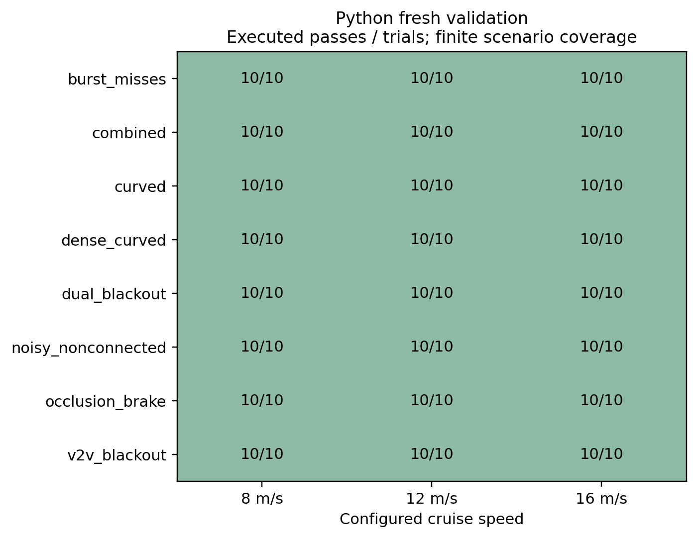
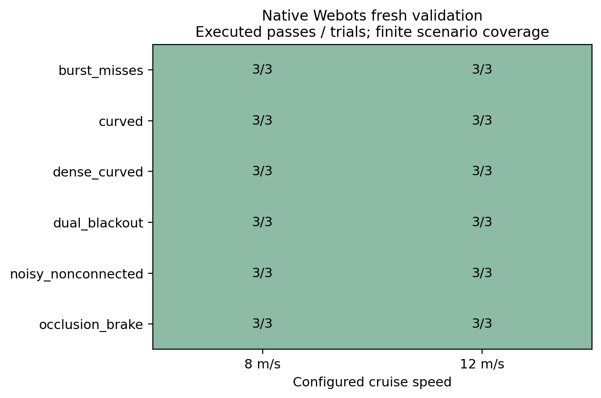
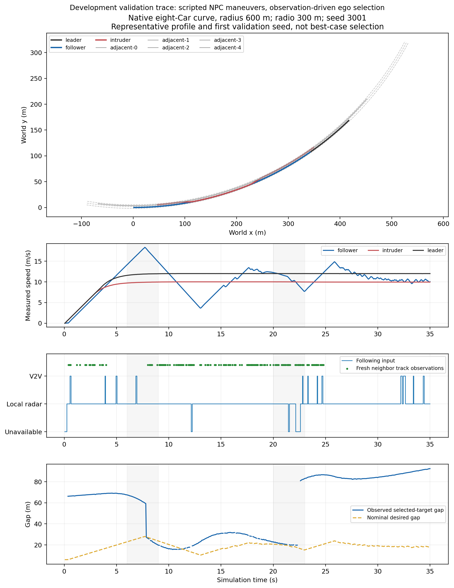

# Broader following validation and communication operating envelope

This stage implements observation-driven following under curved roads, eight-car
traffic, non-connected vehicles, occlusion, noisy/missed sensing and communication
faults. It adds positive exit assessment from neighbors' own anonymous Radar
observations and bounded forwarding of original beacons. Previous experiments
and evidence remain preserved. Final thesis comparison/benchmarking is on hold.

The complete native workflow is validated in an explicitly configured **300 m
communication envelope**. The separately preserved 150 m cohort has a recovery
failure; it is not represented as passing under the same conditions.

## Executed checks

| Check/cohort | Result | Scope |
| --- | --- | --- |
| Complete connected-V2V pytest suite | **146 passed** | Existing and new tests |
| Python development | **72/72 passed** | 8 profiles × 3 speeds × 3 development seeds |
| Fresh Python validation | **240/240 passed** | 8 profiles × 3 speeds × 10 new seeds |
| Native 150 m development | **12/12 passed** | 6 profiles, 8 m/s, 2 development seeds |
| Fresh native 150 m diagnostic | **35/36 passed** | 6 profiles × 2 speeds × 3 new seeds |
| Native 300 m development | **12/12 passed** | Unchanged controller; explicit range configuration |
| Fresh native 300 m validation | **36/36 passed** | 6 profiles × 2 speeds × 3 different new seeds |
| Independent stdlib scoring/source/wire audit | **Passed** | Both final stages; 150 m failure independently confirmed |
| Cooperative Python sensor regeneration | **Passed** | 45,405 development + 151,727 validation datagrams |
| Semantic corruption checks after rehashing | **Rejected** | Altered aggregate and native wire state |

All final cohorts, including the failed 150 m episode, had **zero sampled all-pair
oriented-box overlaps, route-corridor violations, stale selected-source use,
requested actuator-bound violations and blind-braking violations**. The independent
audit also checks requested steering rate and bounds for every native car.
These sampled checks are finite simulation evidence, not continuous-time or
physical-world collision-free assurance.

Python final output: `results/robustness-v6` (32 s, 20 Hz control). Native 150 m:
`results/robustness-native-v2`; native 300 m: `results/robustness-coverage300-v1`
(35 s, 700 control samples per car). The main Python cohort contains 199,680 ego
ticks across development/validation. Each native envelope contains 156,800 vehicle
samples across its development/validation grids. Every applicable case completed
receiver/control replay, native sensing-source checks and source/world/controller
hash checks; Python also completed shared-bicycle transition replay.

## What the failure established

In the 150 m native trial `noisy_nonconnected-12-2003`, the follower stayed safe
but the head vehicle left every available communication path. The intervening
vehicle was non-connected and could not relay. The episode had 150.02 m progress
(168 m required), no demonstrated head reacquisition and 11.3 s stopped time.
Inventing knowledge from silence would not resolve that information loss safely.

A separate predeclared operating-envelope experiment changed only generated
Emitter ranges and the generated controller's `setRange` literal to 300 m. Inverse
replacement asserts that original template bytes are otherwise unchanged. Local
Radar remains 120 m; original source TTLs, gains, bounds, noise and maneuvers remain
unchanged. Fresh 300 m seeds are **3001, 3011, 3019**, distinct from the original
150 m validation seeds **2003, 2011, 2017**. Both cohorts are fully retained.

The 300 m result demonstrates the configured simulation envelope. It does not
establish a stronger controller at 150 m, a matched causal performance improvement,
or a real radio link budget/range guarantee. See [COVERAGE_PROTOCOL.md](COVERAGE_PROTOCOL.md).

## Recovery and spacing are separate measurements

The pass gate requires correct fresh target acquisition/return samples and at
least 40% of configured cruise distance, along with the unchanged safety checks.
A separate stable-return metric requires one continuous second of correct target
association. One Python validation trial (`combined-16-1051`) met the sample/progress
gate but did not demonstrate that continuous interval before the episode ended;
its stable-return time is reported as censored. All 36 native 300 m validation
trials demonstrated that stable interval.

Nominal time-headway settling is still limited by the conservative adjacent-traffic
guard. Correct-target spacing RMS reached **187.36 m** in Python and **136.56 m**
in the 300 m native cohort. These conditional RMS values cover correctly associated
scoring windows and must be read with progress, unavailable-input time and censoring.
They do not imply small formation error throughout an episode. The maximum stopped
time was **5.7 s** in Python and **0.85 s** in native 300 m validation. The minimum
progress/cruise-distance ratios were **0.413** and **0.719**, respectively.

Full per-profile [tables](evidence/validation-tables.md) and raw summaries retain
these outcomes. No safety stop is relabeled as successful nominal formation settling.

## Coverage and representative trace

Python profiles: curved, dense_curved, noisy_nonconnected, burst_misses,
occlusion_brake, dual_blackout, v2v_blackout and combined; speeds 8/12/16 m/s.
Fresh seeds: 1009,1013,1019,1021,1031,1033,1039,1049,1051,1061.

Native profiles are the first six above, at 8/12 m/s. Dense cases contain eight
physical generic Cars; other cases contain three. Curved native roads have radius
600 m; Python uses 800 m. Native physical road meshes, local GPS/body velocity,
IMU/Gyro, actual Radar and Emitter/Receiver are used. Other robots' Supervisor
positions do not enter ego control. NPC maneuvers are scripted; ego target choices
are driven by observations. Non-connected actors never transmit or relay.

The representative profile and first validation seed were chosen by a fixed rule,
not by the best outcome. The trace shows the large post-cut-out head gap as well
as successful identity reassociation. PDF versions are available with the figures.

## Retained development history

| Attempt | Trials | Gate failures |
| --- | --- | --- |
| Python robustness-v1 | 72 | 11 |
| Python robustness-v2 | 72 | 13 |
| Python robustness-v3 | 72 | 6 |
| Python robustness-v4 | 72 | 0 |
| Python robustness-v5 | 72 | 1 |
| Python robustness-v6 final | 72 | 0 |
| First native development | 12 | 3 |
| Corrected native development | 12 | 0 |

The [protocol](PROTOCOL.md) records the fixes: anonymous-to-radio identity continuity,
positive departure proof, avoiding a false 120 m radio relevance cutoff, noise-aware
lane entry, fresh-priority association, forwarding priority and actual cooperative
sensing. An early probe also exposed an invalid NPC rear-headway fixture; it remains
preserved. None of the failed/invalid attempts was overwritten. Validation seeds
were opened after the relevant source freeze and development gates.

## Evidence and reproducibility

The [archive index](evidence/INDEX.md) and [SHA-256 checksums](evidence/SHA256SUMS)
cover full final Python and native cohorts, the **complete** 150 m diagnostic
cohort, source freezes, actual generated controllers/worlds, protocols, verification
records and figures. Shards are below 32 MiB. History shards retain all earlier
cohort summaries/source and failed raw trials; full earlier successful preliminary
raw data also remains in the prepared environment. Runtime binaries are installed
separately from pinned/checksum-verified releases.

A reproducibility supplement supplies the shared native GPS/body-velocity
converter, which was omitted from the newer explicit file list. Its bytes match
the earlier archived native source freeze and versioned checkpoint `c7089f3d`.
Original experiment manifests/outcomes are unchanged. Full Git checkouts already
contain it; the supplement makes the extracted source trees self-contained.

Independent audits import no controller/plant/NumPy. The input regenerator separately
rebuilds cooperative sensor bytes. Corruption checks update ordinary hashes before
testing semantic rejection. All archive members are checksum-verified; the extracted
artifact is audited again. Commands are in [README.md](README.md).

The implementation assumes known-route geometry, common clocks, approximately
route-aligned traffic and trusted sensing claims. It does not implement PKI,
realistic RF congestion, arbitrary hidden-object recovery, learned perception,
real-time guarantees or string-stability proof. Neighbor observations help where
an actual fresh view and communication path exist. Final thesis benchmarking and
superiority claims remain on hold.

Cloud installation/startup instructions are saved separately from Git. Publishing
the prepared snapshot is a product UI action; fresh-task restoration is not claimed
without that publication and a separate check.
