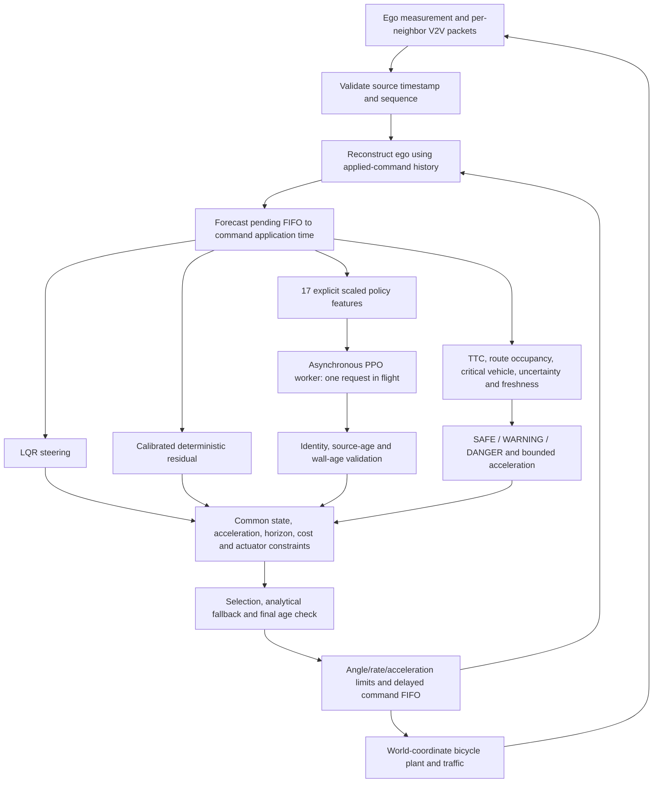

# Unified LANS simulation pipeline v1

This package implements the integrated opening-report architecture in one control
loop: an LQR baseline, bounded deterministic and PPO steering corrections,
application-time prediction, timestamped V2V state, risk supervision, common-cost
candidate selection, longitudinal intervention and constrained command fusion.
It is a **new research integration**, not a relabeling of the frozen LANS or
LANS-RISK experiments. Historical source, models and result files are untouched.



## Run

Run from `/workspace/LANS`, using the existing isolated checkout; no worktree is
needed. Python 3.10 and the LANS virtual environment supply NumPy, SciPy,
Gymnasium, PyTorch, Stable-Baselines3 and pytest. No risk-environment dependency,
network service, secret, model API or paid infrastructure is required.

```bash
cd /workspace/LANS
export OMP_NUM_THREADS=1 OPENBLAS_NUM_THREADS=1 MKL_NUM_THREADS=1
export TF_CPP_MIN_LOG_LEVEL=2 MPLCONFIGDIR=/workspace/lans-setup/mpl
P=/workspace/lans-venv/bin/python

# Use NEW output paths; commands refuse to overwrite existing evidence.
$P -m integrations.unified_lans calibrate --output results/my-unified/calibration.json
$P -m integrations.unified_lans train --output results/my-unified/policies \
  --steps 2048 --seeds 42 43 44

# One command runs the whole integrated pipeline, real spawned worker included.
$P -m integrations.unified_lans run --suite --compare --seconds 3 \
  --policy results/my-unified/policies/seed-42 \
  --calibration results/my-unified/calibration.json \
  --output results/my-unified/validation
$P -m integrations.unified_lans.verify results/my-unified/validation
$P -m pytest tests integrations/unified_lans/tests -q
```

Prepared artifacts in this session use `results/unified-v1/`: `calibration.json`,
`sealed-policies/seed-{42,43,44}` and `validation/`. An earlier unsealed integration
training pass is preserved in `policies/`; use the sealed bundles above.
`VALIDATION.md` records the actual validation outcomes. Models and large raw
outputs are ignored by Git under `results/`; retain that directory or archive it
when transferring a prepared environment.

For GitHub handover, [the verified evidence bundle](evidence/LANS_Unified_Pipeline_v1.zip)
retains all three sealed policies, training-source snapshots, calibration and the
62 audited episode traces. Its outer checksum is in [SHA256SUMS](evidence/SHA256SUMS),
and `BUNDLE_MANIFEST.json` inside records every member's SHA-256. From the repository
root, `unzip -n integrations/unified_lans/evidence/LANS_Unified_Pipeline_v1.zip`
restores the ignored `results/unified-v1/` artifacts without overwriting existing
files. The archive contains the pre-handover documentation snapshot; the current
tracked README and validation notes govern the GitHub handover.

`--mode lqr|fixed|deterministic|ppo|hybrid` selects a comparator while preserving the
same risk supervisor, longitudinal control, physical FIFO and actuator limits.
`--compare` runs all five on matched initial cases and network seeds. This
isolates proposal/selection behavior, not the complete removal of supervision.
The full suite includes following, merging, crossing, curved tracking, delayed
packets plus command delay, packet loss, out-of-order packets, traffic blackout,
ego blackout, 300 ms inference stall, worker termination and 20% tire-stiffness
mismatch. Default execution is wall-paced; `--fast` is explicitly unpaced and
does not supply comparable asynchronous timing evidence.

## Contracts and implementation choices

- The shared six-state plant is `(x, y, heading, speed, lateral speed, yaw rate)`
  in SI units, integrated with RK4 substeps of at most 10 ms. Positive steering
  and heading turn left. Below 2 m/s a documented kinematic relaxation avoids
  singular dynamic-bicycle divisions. The predictor uses nominal stiffness;
  the plant can differ. NPC prediction is constant velocity; curved NPC truth
  follows its route, providing a deliberate prediction mismatch.
- LQR reuses `controllers/lqr_controller.py`, with gains scheduled on 0.5 m/s
  bins. Exactly one owner fuses the residual into LQR. Angle is bounded to
  0.5 rad, steering rate to 0.6 rad/s and acceleration to [-6, 2.5] m/s².
  Acceleration has hard bounds but no jerk constraint; jerk is measured.
- A command issued at `t` applies at `t + delay`; delayed commands are never
  magically canceled by a later fallback. Prediction uses the actual applied
  history and pending FIFO. Delay must be an integer number of 50 ms ticks.
- Ego and each configured neighbor retain their own original observation time
  and monotonic sequence. Invalid/future/nonfinite/old packets are rejected.
  Arrival does not reset information age. The neighbor registry is explicit;
  this harness does not claim discovery of arbitrary unseen traffic.
- Fresh traffic is extrapolated to application time, with age-growing spatial
  uncertainty. Geometric disc TTC and crossing-route occupancy identify the
  critical vehicle. Scenario-specific SAFE/WARNING/DANGER thresholds have
  hysteresis. Missing/stale registered traffic causes analytical steering and
  maximum bounded braking; missing/stale ego measurement causes held steering
  and braking, explicitly labeled `hold_brake`, not fabricated LQR output.
- Nominal acceleration, reduced/braking acceleration and steering candidates
  share the same anticipated application state. Baseline, deterministic and
  fresh PPO candidates are scored with a common 0.5 s tracking/heading/steering-
  rate objective and uncertainty-expanded clearance checks. No feasible sampled
  prediction triggers LQR/braking fallback; this is not a safety certificate.
- PPO assistance in the forecast stops at its remaining valid lifetime and is
  then replaced by analytical control. Sequence/request identity, simulated
  source age, actual monotonic age and final pre-issue age are checked. Worker
  failure cannot block control; only the owned worker and queues are cleaned up.
- Thresholds and engineering uncertainty rates are explicit initial defaults,
  not statistically calibrated safety guarantees. The deterministic gains use
  a fixed finite development search over 12 pairs and 12 states per pair;
  neither comparison cases nor final-test data select those gains.

## PPO contract and provenance

The new policy has **17 scaled features and one normalized scalar action**:
four tracking-error features, speed, four previews, ego age, last completed
response delay, bounded TTC and clearance, traffic age, actually applied steering
and acceleration, and worker-busy status. Fixed published scales are applied in
`Pipeline.features`; no hidden normalization state is needed. Runtime requests
are submitted only while idle. The normalized action is scaled once by 0.08 rad.

Historical 11-/18-/other-feature policies are refused. New bundles have their own
contract, action semantics, policy SHA-256, seed, version/config record and a
training source snapshot. Saved SB3 policy archives include the optimizer state;
this package does not claim exact interrupted-environment/RNG resume support.

Three finite 2,048-step training runs demonstrate integration only. Training
uses synchronous requests and actual selected/FIFO-applied transition rewards;
credit is attributed to submitted proposals even when the gate rejects them.
It is not executed-action-only PPO credit. Asynchronous deployment and fault
distributions differ and need a separately frozen scientific training/evaluation
study. These short policies are not promoted research controllers.

## Evidence boundaries

Every run writes source/policy provenance, the effective configuration, complete
per-tick state/action/packet-age/risk/cost telemetry, neighbor truth for auditing,
and summary metrics. Truth is used only for scoring, termination and the explicit
CV hazard reference; controller inputs come from validated packets. Warning
precision/recall uses that current-truth CV proxy, not eventual-collision labels.
The replay auditor checks hashes, command/FIFO contracts, freshness, fallback,
state integration, tracking and clearance summaries. Shared-dynamics replay is
not an independent simulator or scientific peer review.

The 50 ms loop is a configurable engineering simulation schedule, not the old
10 ms timing requirement. Report measured misses honestly. A 3 s validation
episode is not full-route completion; `completed_duration` means the requested
simulation interval ran. Travel, collision and corridor metrics remain separate.
No Webots, hardware, formal stability/safety, universal PPO benefit or publication-
ready claim follows from this integration. Selected native Webots transfer and
longer, untouched held-out scientific studies remain separate validation work.
The outstanding historical risk-study batches are not launched by this package.
