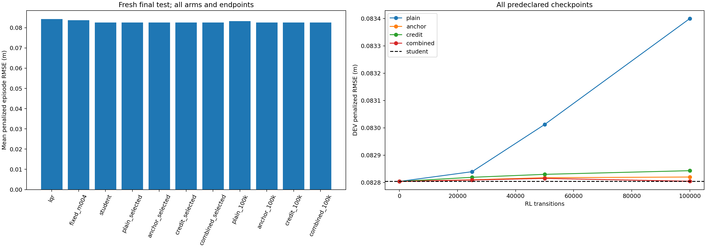

# Anchor and credit pilot complete: forgetting reduced, incremental gain unproven

**All four arms fail the frozen1% incremental improvement screen.** The student anchor works as a retention mechanism, but this pilot does not establish a materially stronger controller than the supervised student. Retain that student as the recommended research reference; no new model is promoted.

The user-authorized experiment completed **1,200,000 additional RL transitions**: four arms × three paired fresh RL seeds ×100k. All start from the same paired Step2 student, fixed train-only normalization and matched fresh critic/optimizer. Physical execution, gate, observer and20 actor inputs remain unchanged. The [pre-experiment reward audit](../../research/revision10/reward-audit.md) distinguishes actual implementation behavior from causal hypotheses.

## Fresh final comparison: development-selected checkpoints

Checkpoint selection used2,052 development episodes and was committed/pushed as `3fbf54a` **before** the1,188 fresh final episodes. Each method has108 final episodes on three seed/noise pairs, three speeds, two known paths and six conditions. All11 methods survive108/108 cases. Mean penalized episode RMSE; lower is better.

| Method | RMSE (m) | Reduction vs LQR | Result vs student |
|---|---:|---:|---|
| LQR | 0.084318 | — | — |
| Fixed−0.04 + gate | 0.083672 | 0.766% | — |
| **Frozen supervised student** | **0.082605** | **2.031%** | Reference |
| Plain PPO selected (all step0) | 0.082605 | 2.031% | Identical |
| Anchor-only selected | 0.082620 | 2.014% | 0.017% higher error |
| Credit-only selected | 0.082600 | 2.038% | 0.007% lower error |
| Combined selected | 0.082614 | 2.021% | 0.011% higher error |

The tiny selected credit reduction is about0.006mm mean episode RMSE and does not meet the1% threshold or improve all three seed means. Combined does not improve the selected result. All regional preservation/survival checks pass for the selected arms. The student is1.275% better than fixed−0.04 on this new split; differences from earlier reported baseline percentages reflect different predefined noise streams.

## Endpoints retained without final-test selection

| Fixed100k endpoint | RMSE (m) | Change relative to student |
|---|---:|---|
| Plain PPO | 0.083204 | 0.725% higher error |
| Anchor-only | 0.082597 | 0.010% lower error |
| Credit-only | 0.082632 | 0.033% higher error |
| Combined | 0.082595 | 0.013% lower error |

The combined100k endpoint has a slightly lower final mean than the student (about0.011mm), but it is **not substituted for the development-selected model**. This descriptive endpoint difference is far below the frozen1% screen and is not a demonstrated research advance. All checkpoints, per-seed/per-region rows and endpoint factorial contrasts remain in the [generated report](report.md) and [decision](decision.json).

## What changed and what was learned

| Change | Implemented behavior | Measured interpretation |
|---|---|---|
| Fixed student anchor | Coefficient1 KL(student||actor), half current observations/half existing TRAIN-observation replay; frozen student, no new teacher-class labels | At100k, old DEV action agreement averages99.08% for anchor-only and98.75% for combined, versus84.43% for plain. Retention improves; tracking gain does not follow automatically. |
| Proposal-specific credit | Compare one submitted proposal against zero from cloned current state/observer/worker, then zero future proposals; actual gate/nonlinear plant,200ms zero-innovation forecast | Credits are nonzero when the predicted submitted packet can affect execution. Training-only model credit remains potentially biased; it is not an actual future observation. |
| Ignore in-flight actor actions | No credit for an unsubmitted action; exclude its PPO actor/entropy gradient, retain all critic transitions | Availability matches pre-action observed history and actual worker submission in tests. Credit-only limits plain PPO degradation but does not pass the incremental gain screen. |
| Factorial controls | Plain/anchor/credit/combined, same initial weights and RL-transition budget | Endpoint anchor and credit contrasts reduce plain PPO degradation in all three pairs. This is descriptive prevention of regression, not evidence of1% improvement over the student. Credit combines reward and masking, so those subcomponents are not separately identified. |

Full [off-policy drift diagnostics](actor-drift.md) use only existing Step2 DEV rows/labels and never influence training or selection. Anchor replay uses TRAIN observations only. Online counterfactual reward computation is privileged training; hidden state/plant parameters and actual future noise never become actor inputs.

## Why this does not close the performance problem

The audit found attribution and continuation mismatches, and this experiment tests a specific alternative. It does not prove that the old reward caused every regression or that all learning limitations are fixed. A single-request forecast with zero future requests can undervalue coordinated sequences, especially through a persistence gate; zero future innovations can bias credit. The anchor preserves useful decisions but can also preserve the student's limitations. Known-task observation ambiguity, finite residual choices and existing gate authority still constrain achievable gains. Earlier oracle/teacher numbers are finite references, not an absolute ceiling.

The supported next decision is to **stop this configuration at its declared budget** and retain the student. Before spending more PPO compute, a separate headroom/teacher-quality diagnostic would need to establish a meaningful improvement target beyond this student under realistic observations and the chosen execution constraints. No additional diagnostic, gate opening, reward tuning, coefficient search or teacher-label collection was launched here.

## Verification and scope

Five contract tests cover exact transfer/fresh critic, frozen anchor gradients/save-load, stock-PPO update equivalence at zero anchor, original-object counterfactual parity/no mutation, unchanged physical trajectories, ignored-action masking, stale fallback, split separation and checkpoint selection. Forty-eight saved models and their optimizer states are audited. Thirty-six actual saved-policy traces replay through original Sensor/Execution/plant objects, with saved input/action/state fields checked. Twelve training snapshots match critical frozen code; inherited configuration copies are separately verified against the training-freeze git objects.

[All DEV rows](dev/episodes.csv), [selection](dev/selection.json), [all final rows](evaluation/episodes.csv), [all48 checkpoints](training/), [provenance and input hashes](provenance.json), [source audit](source-verification.json), [model/replay audit](independent-verification.json), and [optimization diagnostics](optimization-diagnostics.json) are retained. RL-transition budgets match, but anchor and counterfactual compute overhead differs. Wall training time is descriptive, not a controlled compute-efficiency benchmark.

Three optimization/noise pairs and known geometries/condition families only. No native/reserved campaign, unseen-domain validation, real-vehicle deployment, stability/safety proof or independently strong MPC comparison. Severe100ms latency remains exact LQR fallback. These internal checks are not a new external ARIS verdict. No production promotion follows this pilot.
