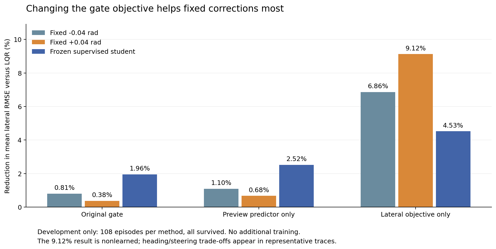

# Revision12 outcome: the objective matters, but the largest gain is nonlearned

Finalized 26 October 2026. Executable and protocol freeze: `c49ddc065caf9c93eb4867b91446a8037a11ffc7`, committed and pushed before the development run. [Frozen protocol](source/revision12/protocol.json), [generated report](report.md), [selection](selection.json), [raw episodes](episodes.csv), [verification](verification.json).

**All 1,080 development episodes survived. Changing only the gate objective increased the frozen student's mean lateral tracking improvement over LQR from 1.955% to 4.528%. However, the same gate with predeclared constant corrections achieved 6.864% and 9.122%.** The strongest measured result in this experiment is therefore nonlearned. Neither learned variant satisfies the frozen criteria for further training; reserved evaluation remains unopened.

## What was compared

Three gates were crossed with three proposal sources: fixed −0.04 rad, fixed +0.04 rad, and the unchanged supervised student. Pure LQR was the common reference. Three student/noise pairs, three speeds, two known paths and six conditions gave 108 episodes per method. These are fresh development noises, not unseen task families or a reserved confirmation campaign.

- **Legacy gate:** original nominal predictor and combined lateral/heading/yaw/steering-effort cost.
- **Preview-only gate:** original dynamics and cost, but evolving curvature from the same three preview channels already available to the actor. No hidden tire parameters were supplied.
- **Lateral-only gate:** original constant-curvature predictor, retaining only its lateral stage and terminal costs.

Physical limits, sensors, actuator dynamics, LQR, residual bounds, fusion limits, age rejection, recovery and worker cadence remained identical. Student weights and train-only normalization remained identical. The +0.04 and −0.04 proposals were both declared before the run; their signs and amplitudes were not tuned to these outcomes.

| Method | Mean penalized lateral RMSE (m) | Reduction versus paired LQR | Survival |
|---|---:|---:|---:|
| LQR | 0.08424021 | — | 108/108 |
| Legacy gate + student | 0.08259318 | 1.955% | 108/108 |
| Preview gate + student | 0.08211425 | 2.524% | 108/108 |
| Lateral gate + student | 0.08042610 | 4.528% | 108/108 |
| Lateral gate + fixed −0.04 | 0.07845764 | 6.864% | 108/108 |
| Lateral gate + fixed +0.04 | 0.07655554 | 9.122% | 108/108 |



The generated report retains all ten methods, every region, all three paired seed means and all denominators. All severe 100 ms cases reproduce LQR exactly in logged trajectory digests, scores and zero learned authority. This is fallback, not a learned improvement. The unchanged legacy student measures 1.955% on this fresh development grid; that does not overwrite its earlier 2.158% and 2.068% results on different noise grids.

## What this says about the earlier approximately 2% gain

The controlled objective change has a material effect on lateral RMSE. With the **same positive constant proposal**, switching only the supervisory objective reduces error by 8.780% relative to that proposal under the legacy gate. The corresponding LQR-relative improvement rises from 0.376% to 9.122%. The frozen student also improves by 2.624% relative to itself under the legacy gate.

This supports an objective trade-off as one concrete limitation of the current controller configuration. The original gate optimizes a combined criterion; the headline evaluation metric measures lateral error. A candidate can be unfavorable to that combined criterion yet useful for lateral RMSE. Removing nonlateral terms changes which actions are accepted and the resulting state histories.

It does **not** establish that those terms were implementation bugs or unnecessary. They express competing control objectives. Nor does this experiment isolate which removed term caused each effect, prove the nominal model accurate, or explain all previous PPO failures. The preview-only student improves only 0.580% relative to the legacy student, below the predeclared 1% progress threshold; this small geometry change alone did not unlock the desired gain.

The same frozen student encounters a different distribution of gate/history features under a new gate. Its poorer result than constants does not prove that no newly trained policy could help. It does show that this experiment has not demonstrated additional learned benefit under the strongest new gate. A future learning claim would have to beat the stronger same-gate nonlearned controls, not just the older LQR-relative number.

## Where the student does and does not reach 5%

| Condition | Lateral gate + student: reduction vs LQR | Lateral gate + fixed +0.04: reduction vs LQR |
|---|---:|---:|
| Nominal | 6.547% | 9.324% |
| Tire mismatch | 4.331% | 11.694% |
| Low friction | 4.536% | 11.851% |
| Sensor stress | 4.926% | 8.085% |
| 20 ms latency | 7.197% | 8.392% |
| 100 ms latency | 0.000% | 0.000% |

The student exceeds 5% in nominal and 20 ms latency averages. The frozen research target specifically required at least two of **tire mismatch, low friction and sensor stress** to reach 5%, with paired-seed consistency and preservation checks. None of those three student means reaches 5%. Thus the generated report correctly records that target as false. Its screen applies to the learned student variants; it does not deny the larger measured reductions of the nonlearned controls.

## Heading and steering trade-offs

After the primary selection was complete, a separate [posthoc trace diagnostic](analysis/tradeoffs.md) examined the already stored trajectories. These cover **one student/noise pair at 25 m/s on DLC**, with one trajectory in each of six regions per method. They do not cover all 108 paired cells for secondary metrics and do not modify selection. The exact frozen path functions reconstruct heading error; actuator rate includes the initial increment from zero.

Percent changes below compare the six-region mean episode metric with LQR. Negative means lower, positive means higher. Their lateral percentages differ from the full-grid table because this is a narrower subset.

| Method | Lateral RMSE | Heading RMSE | Command RMS | Actuator-rate RMS | Actuator total variation |
|---|---:|---:|---:|---:|---:|
| Legacy student | −0.353% | −0.144% | +1.114% | +13.832% | +21.786% |
| Preview student | −1.564% | −1.013% | +0.266% | +13.099% | +21.214% |
| Lateral student | −2.963% | −1.444% | +3.520% | +36.321% | +48.416% |
| Lateral fixed +0.04 | −7.026% | +4.779% | +6.695% | +14.105% | +19.492% |
| Lateral fixed −0.04 | −7.636% | +2.573% | +5.009% | +13.315% | +18.034% |

The positive fixed correction increases heading RMSE in all five active regions of this subset. The lateral student has especially large actuator motion: nominal rate RMS rises 57.515% and total variation 77.102%. These measurements do not imply a physical limit violation—the declared bounds remain satisfied—but they prevent a claim of improvement in every control metric. In the representative tire-mismatch trajectory, lateral-student RMSE is also 0.833% higher than LQR despite the better full-region mean. Aggregate gains must not be described as improvement in every episode.

## Frozen decision and completed work

| Stage | Status | Reason |
|---|---|---|
| Closest-literature positioning | Qualified comparison documented | Primary arXiv/Crossref access remained proxy-blocked; full-text verification and published-algorithm reproduction remain open. |
| Predictor/objective implementations and contract tests | Complete | 17/17 tests passed, including original-executor parity and evidence/selection guards. |
| Paired LQR/nonlearned/student development comparison | Complete | 1,080/1,080 surviving episodes; all ten methods retained. |
| Initial progress and learned-benefit screen | Complete: no eligible variant | Preview fails gate-progress magnitude; lateral passes gate progress but loses to both same-gate constants. |
| Conditional teacher confirmation | Not run under the frozen stop rule | Requires an eligible initial variant. |
| Conditional two 100k training pilots | Not run under the frozen stop rule | Initial eligibility and independent teacher confirmation were not established. |
| Conditional reserved evaluation | Unopened | No policy/design qualifies for that stage. |

The lateral student is 2.509% worse than the negative constant and 5.056% worse than the positive constant under the same gate. Its failure to demonstrate learned benefit is why a larger raw LQR-relative percentage does not trigger retraining or promotion. No post-result threshold, authority, model, horizon or policy change was made. Additional RL steps: **0**.

For any later revision, a defensible question is whether a gate can preserve these lateral benefits while controlling heading and steering activity, and whether learning adds value beyond both fixed controls. That would require a new predeclared objective/benchmark and untouched confirmation data. It is not permission to relabel the present 9.122% as an AI result or to tune until a desired number appears.

## Verification, reproduction and limits

The [17-test logs](checks/summary.json), [independent verification](analysis/independent.md) and [raw diagnostic JSON](analysis/tradeoffs.json) are retained with reproducible scripts. Independent arithmetic confirms full grid membership, means and survival by method/region/seed, the selection decision, 21 source hashes against archive/manifest/frozen git commit, and nine student artifact hashes. Across 18 severe-delay cells, all 162 non-LQR comparisons have identical recorded trajectory hashes and scores. Available severe traces also have identical recorded physical fields. Sparse traces omit two physical state components, so the independent checker does not claim to reconstruct every full trajectory hash from telemetry.

Use the [revision README](../../research/revision12/README.md) to reproduce the frozen development run into a new directory. The existing results can be independently checked without new simulations, using standard-library Python:

```bash
python integrations/webots/results/revision12-ablation/analysis/independent.py \
  --repo "$PWD" --output /tmp/lans-v12-independent-new.json
python integrations/webots/results/revision12-ablation/analysis/tradeoffs.py \
  --repo "$PWD" --output /tmp/lans-v12-tradeoffs-new.json
```

The [chart script](analysis/plot.py) renders existing CSV rows only. With the pinned environment's Matplotlib, pass `--run integrations/webots/results/revision12-ablation --output /tmp/lans-v12-comparison-new.png` to reproduce the figure.

The run used Python 3.10.22, NumPy 1.23.5, Torch 2.0.0+cpu and Numba 0.57.1, with three single-thread shards. Surrogate compute time is not native inference timing or a hard real-time guarantee. All results concern known geometries and condition families; three student/noise pairs do not establish statistical or broad-domain superiority. No current-student native transfer, real-vehicle safety, stability certificate, full-literature novelty proof or state-of-the-art claim follows. [Literature positioning and source limitations](../../../../docs/research/literature-positioning.md) remain explicitly separate from this controlled experiment.
