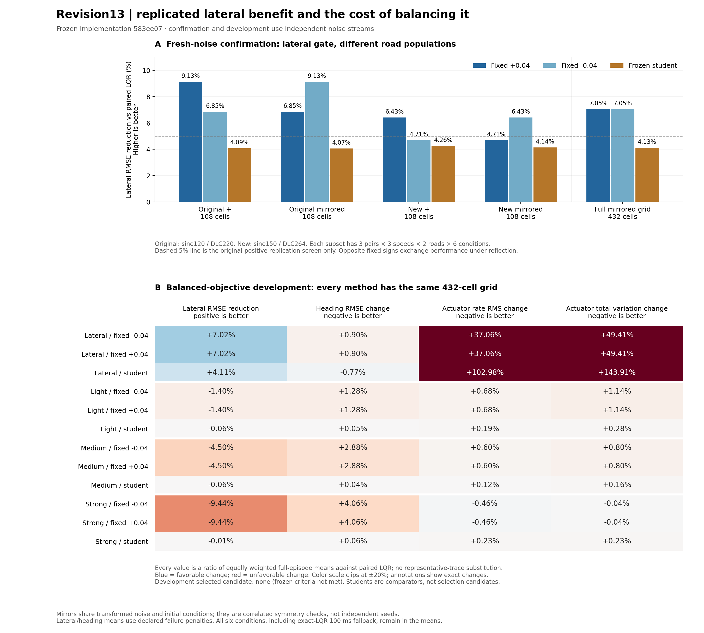

# Mirrored confirmation and balanced-control outcome

The earlier 9.122% lateral-tracking result replicated at **9.131%** on the same original positive-orientation roads with fresh noise. On the expanded left/right grid, the nonlearned fixed corrections each improve mean lateral RMSE by **7.049%**, with substantial additional steering activity. The three predeclared balanced objectives reduce that activity but make lateral tracking worse than LQR. **No balanced controller qualifies; reserved evaluation, native transfer, teacher headroom and PPO pilots remain untriggered.**

Executable/protocol freeze: [`583ee07e1ec8f8ce61eb457796e301f8dd9750ac`](https://github.com/rizwanalihasalivi/LANS/commit/583ee07e1ec8f8ce61eb457796e301f8dd9750ac), committed and pushed before any revision13 outcome. The source snapshots and unchanged student hashes are recorded in each phase's `complete.json`. [Protocol and reproduction](../../research/revision13/README.md). The earlier [revision12 evidence](../revision12-ablation/interpretation.md) remains unchanged.



## Fresh confirmation

[Full report](confirmation/report.md), [raw episode records](confirmation/episodes.csv), [verification](confirmation/verification.json).

All 2,160 episodes survived. Each of five methods has 432 matched cells: three noise/model pairs, three speeds, four base geometries in both orientations, and six operating conditions. Mirrored cases share reflected noise and initial errors; they are correlated symmetry checks, not additional independent seeds. The original-positive subset contains 108 cells per method and matches the earlier task distribution. The other subsets test the fixed sign's dependence on path orientation and the two new development geometries.

| Confirmation population | Fixed +0.04 gain vs LQR | Fixed −0.04 gain vs LQR |
|---|---:|---:|
| Original positive roads, exact replication subset | 9.131% | 6.854% |
| Original mirrored roads | 6.854% | 9.131% |
| New positive roads | 6.434% | 4.709% |
| New mirrored roads | 4.709% | 6.434% |
| All eight roads | 7.049% | 7.049% |

The exact replication screen passes, including lower mean error for all three pairs, preserved survival and exact severe-delay fallback. Reflection swaps the better correction sign; the global signs tie exactly on the balanced mirror grid. Thus the old 9.12% figure is reproducible on its original distribution, but it is not a universal gain independent of road distribution or correction sign. The expanded-grid 7.049% is a different-population mean, not a failed exact replication of 9.122%.

Across the full confirmation grid, LQR mean lateral RMSE is 0.06914495 m, fixed corrections 0.06427074 m, lateral-gated student 0.06629175 m (4.126% gain), and legacy-gated student 0.06781289 m (1.926% gain). Fixed correction increases mean heading RMSE by 0.833%, actuator-rate RMS by 36.543%, and total actuator movement by 48.823% versus LQR. These secondary metrics now cover **every episode**, rather than only representative traces.

## Balanced development

[Full report](development/report.md), [raw episode records](development/episodes.csv), [all frozen candidate checks](development/selection.json).

All 5,616 episodes survived. Each of 13 methods has the same 432-cell development grid, with a separate fresh noise namespace from confirmation. Only this phase can select a controller. The three fixed profiles use heading/rate cost weights (0.05, 0.01), (0.10, 0.03), and (0.20, 0.10); horizon, predictor, authority, recovery, packet lifecycle, actuator and plant are unchanged. Both fixed signs and the unchanged student are tested under each gate. Student rows are comparators; the six fixed-control candidates are the declared selection set.

The following values are equal-weight means of per-episode metrics. A positive tracking gain means lower lateral RMSE; positive secondary changes mean higher heading error or steering activity. Fixed ± rows combine identical reported means, not pooled additional repetitions.

| Development controller | Lateral RMSE (m) | Gain vs LQR | Heading change | Rate RMS change | Movement change |
|---|---:|---:|---:|---:|---:|
| LQR | 0.06907929 | — | — | — | — |
| Lateral-only fixed ±0.04 | 0.06423193 | +7.017% | +0.898% | +37.063% | +49.408% |
| Lateral-only student | 0.06623960 | +4.111% | −0.767% | +102.984% | +143.912% |
| Balanced light, fixed ±0.04 | 0.07004306 | **−1.395%** | +1.283% | +0.683% | +1.136% |
| Balanced medium, fixed ±0.04 | 0.07219097 | **−4.504%** | +2.880% | +0.596% | +0.799% |
| Balanced strong, fixed ±0.04 | 0.07560223 | **−9.443%** | +4.059% | −0.458% | −0.036% |

All six fixed balanced candidates reduce rate RMS by at least 26.54% and total movement by at least 32.30% relative to their same-sign lateral-only control. They pass the movement, survival and fallback budgets. However, all fail the lateral gain, gain retention, pair consistency, road consistency, nominal preservation and active-region tracking criteria. Medium also fails the overall heading budget; strong fails both overall and active-region heading budgets. This is not merely missing a 3% gain threshold: all three fixed profiles have **higher** overall error than LQR and degrade nominal tracking.

Balanced students also provide no positive aggregate tracking gain: their RMSE is 0.061%, 0.056% and 0.014% above LQR for light, medium and strong. From the complete episode records, their mean active-tick fractions are only 0.264%, 0.100% and 0.102%, versus 18.651% for the lateral-only student. This is descriptive evidence of near-LQR execution under these profiles; it does not establish that new training could never improve them. The current frozen learner is the revision8 supervised student, **not evidence of a newly improved PPO policy**.

## Decision and verification

`selected_candidate: null`; `next_action: stop_reserved_native_and_learning`.

The tracking/smoothness milestone was **not achieved**. No weights, bounds, criteria, models or noise seeds were changed after inspecting outcomes. No reserved controller episodes, native Webots cases, teacher searches or training steps were run. The conditional reserved/native implementation and its authorization checks are present and tested, but they are not performance evidence. The shared Webots installation, primary specification, phase1 and historical artifacts remain unchanged.

The [independent audit](verification/independent-verification.json) uses a [separate standard-library checker](verification/independent_check.py) that does not import the project reporter or controller. It confirms:

- 7,776/7,776 survivors and complete paired grids; all report aggregates and six selection decisions match raw records.
- 1,152 non-LQR severe-delay comparisons with exactly equal command/physical-state hashes and metrics to paired LQR.
- 2,592 fixed-control/LQR reflection comparisons with zero metric discrepancy.
- Reconstruction of heading, rate, movement, squared sums and physical hashes for all 432 declared saved traces, covering 485,568 transitions.
- All-episode squared-sum/count/RMS and movement-energy consistency. Direct trajectory reconstruction of movement is limited to the saved trace subset; full telemetry was not archived for every episode.

The [pre-outcome test record](verification/tests/summary.json) contains 32 passing tests across geometry/sensors, gate parity and cost arithmetic, reporting, provenance, reserved/native authorization and worker submissions. The [geometry screen](verification/geometry-preflight.json) samples declared paths only; it is not a closed-loop reserved evaluation or a safety certificate. Observed physical bounds and simulated fallback are separate from wall-clock deadline guarantees.

## What this establishes, and what remains open

The large lateral gain is a repeatable **nonlearned gate/correction effect** on the declared tasks, accompanied by extra steering activity. It is not an incremental learning result. These three weighted objectives demonstrate a concrete trade-off: movement falls, but tracking and sometimes heading worsen. They do not prove that a balanced controller is impossible or isolate which objective term causes each change; heading and rate penalties vary together. Any further design must be a separately declared experiment with fresh selection/confirmation data. This revision stops at its predeclared boundary.

The primary-paper review remains incomplete: seven requests failed at the network proxy with HTTP 403. [Source verification and overlap matrix](../../../../docs/research/literature-primary-check.md), [raw access log](verification/literature-access.json). No paper-specific omission, priority, formal safety or published-method superiority claim follows from this result. The latest [real-worker timing experiment](../../../../docs/research/realtime-latency-2026-10-26/README.md) also retains its strict 10 ms timing failure and causal student-interface limitations. This surrogate campaign does not resolve them.

To reproduce reporting and the independent audit without new experiments:

```bash
/workspace/lans-setup/venv/bin/python integrations/webots/research/revision13/report13.py \
  --run integrations/webots/results/revision13-balanced/confirmation
/workspace/lans-setup/venv/bin/python integrations/webots/research/revision13/report13.py \
  --run integrations/webots/results/revision13-balanced/development
/workspace/lans-setup/venv/bin/python integrations/webots/results/revision13-balanced/verification/independent_check.py \
  --repo "$PWD" --phases confirmation development --output /tmp/r13-recheck.json
```

The independent checker uses the fixed archived source commit and repository result paths. For complete new runs, follow the [source README](../../research/revision13/README.md) with new output directories and the pinned research environment. A rerun is a replication; it is not permission to change this revision's selection decision or open its reserved stage.
