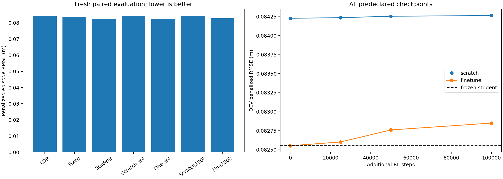

# Step3 complete: retain the supervised student; PPO adds no gain

The user-authorized bounded Step3 pilot completed **600,000 additional RL steps**, two arms × three paired optimization seeds ×100k. The finetune actor exactly inherits all five student logits and its fixed train-only standardizer. The scratch arm shares standardization, a matched fresh critic/optimizer, scenarios and additional RL budget. It does not share Step2's privileged-label pretraining budget. Gate, measured inputs, observer, physical limits and reward remain unchanged.

**The incremental PPO improvement screen fails.** On independent development episodes, all three fine-tuning seeds select **step0**, retaining the original supervised student. Training longer within this frozen pilot did not improve correction quality. The fresh final evaluation confirms degradation at the100k endpoint; no endpoint is promoted.

## Fresh final comparison

Mean penalized episode RMSE; lower is better. Each method has108 episodes, covering three seed/noise pairs × three speeds × two known paths × six condition families. All seven methods survive108/108 cases, giving756 final episodes. This final split is separate from both Step2's540-episode evaluation and Step3's1,188 development episodes.

| Method | RMSE (m) | Error reduction vs LQR | Change vs student |
|---|---:|---:|---:|
| LQR | 0.084307 | — | — |
| Fixed−0.04 + frozen gate | 0.083617 | 0.818% | — |
| **Frozen supervised student + gate** | **0.082563** | **2.068%** | Reference |
| Selected scratch PPO | 0.084189 | 0.139% | 1.969% higher error |
| Selected finetune (all step0) | 0.082563 | 2.068% | Identical |
| Scratch PPO100k endpoint | 0.084290 | 0.020% | 2.091% higher error |
| Finetune PPO100k endpoint | 0.082830 | 1.752% | **0.323% higher error** |

The retained student beats fixed−0.04 by **1.260%**, and LQR by about **1.74mm** mean episode RMSE. These are modest known-family research gains. The100k finetune endpoint adds about0.27mm error versus the student, with worse mean error in every optimization/noise pair. Being better than LQR after fine-tuning does not show that PPO helped: the initialization was already better.

## What the pilot establishes

- Exact transfer works: all24,300 original Step2 DEV rows reproduce identical initial actor logits for each of the three transferred students. Fresh matched critics and empty initial optimizers are verified.
- The failure is not an absent optimizer update. Final finetune Adam step counts are4,983/4,973/4,998; scratch counts are5,000 each. PPO target-KL early stopping accounts for slightly fewer finetune updates. Each job has100 rollouts and exactly100k environment transitions; reward-normalizer counts continue across chunks.
- Finetune development RMSE rises from0.082552 at step0 to0.082850 at100k. Development selection was committed and pushed as `4d72232` before fresh final testing. Final scores did not choose checkpoints.
- Existing DEV observations show cumulative actor drift:100k argmax agreement falls to92.0%/82.1%/82.8%; teacher-cost regret increases for all three actors. [Full drift diagnostics](actor-drift.md) use existing labels only. They are off-policy descriptive evidence, not proof of a unique causal mechanism.
- Per-update target KL0.01 constrains change from the rollout policy, not distance from the initial student. This configuration has no student anchor or imitation replay. Sparse accepted corrections and the existing reward remain plausible credit-assignment limitations; this pilot does not isolate them causally.

## Decision and next research direction

Retain the frozen Step2 student as the stronger research checkpoint. Do not extend this same PPO configuration blindly. A separate, predeclared next pilot could test a student-anchored objective and execution-aware incremental tracking credit, with a matched control and independent selection/test splits. Those changes were **not** run here, and their benefit remains unproven.

The protocol stops at600k additional steps. No extra labels, tuning retries, gate edits or production deployment follow these outcomes. Three optimization/noise pairs and known paths/condition families do not establish unseen-domain performance, native timing, stability, real-vehicle safety or superiority over an independently strong MPC. No new MPC evaluation was conducted in Step3. Latency100ms remains exact LQR fallback.

## Evidence and verification

[Generated report](report.md), [decision and complete checks](decision.json), [development selection](dev/selection.json), [all development rows](dev/episodes.csv), [all final rows](evaluation/episodes.csv), [all24 checkpoints and optimizer states](training/), [provenance](provenance.json), [source verification](source-verification.json), and [saved-model/original-object verification](independent-verification.json) are retained.

Four contract tests pass. Twenty-four saved checkpoints load with the expected interface, normalization and optimizer states. Six frozen training snapshots match the critical training/policy/environment/reward/gate/plant sources. Sixteen actual saved-policy traces replay through the original Sensor/Execution/plant objects with maximum state discrepancy below1e-8. These are internal consistency/replay checks, not a new external ARIS verdict or native simulator validation.
